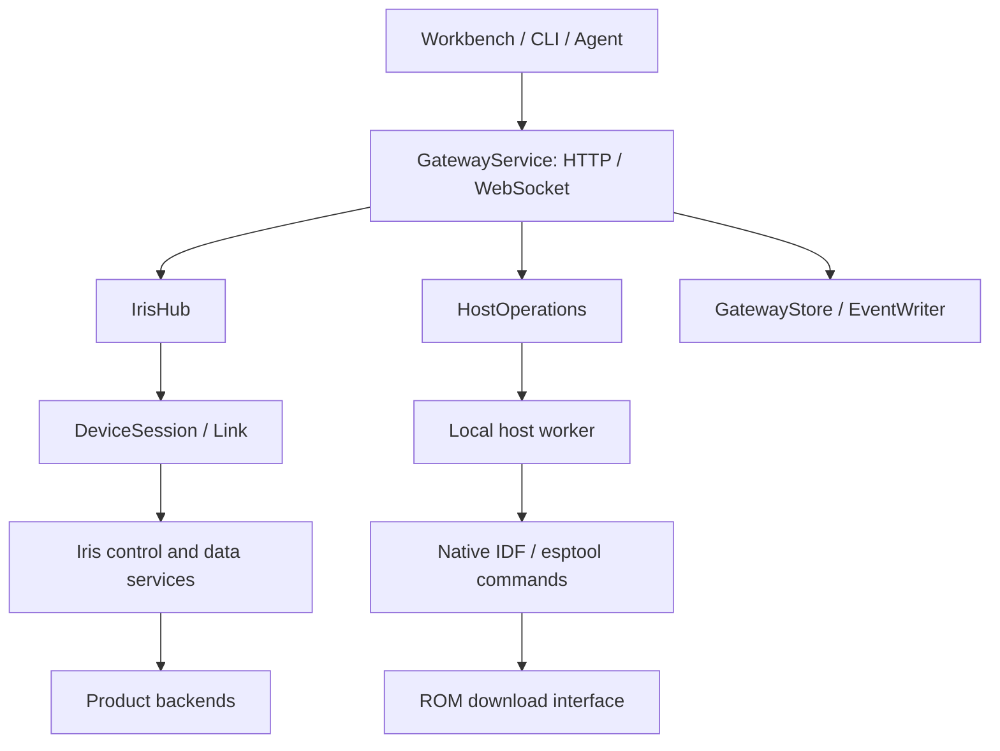

# ESP-Iris architecture

ESP-Iris combines an ESP-IDF device component with a Python Gateway and Web
Workbench. The device exposes bounded services; the host owns connection
management, operation history, artifacts and presentation. Host tools require
Python 3.10 or newer. The current wire and HTTP API major version is 2.

## Runtime structure

| Boundary | Responsibility |
| --- | --- |
| [GatewayService](../tools/iris_gateway/gateway.py) | HTTP authentication, request validation, operations and evidence; device services are accessed through `GatewayHub`. |
| [IrisHub](../tools/iris_gateway/hub.py) | Discovery, reconnect, per-device link association and endpoint ownership. Project sessions add cross-process claims and handoff through `ProjectGateway` and `OwnershipRegistry`. |
| [DeviceSession](../tools/iris_gateway/session.py) / [Link](../tools/iris_gateway/link.py) | Session handshake, request correlation, credits and clock synchronization above serial/TCP byte transport. |
| [Device runtime](../src/esp_iris.c) | Transport and service lifecycle, bounded scheduling and dispatch to registered RPC, media, file and update backends. |
| Product application | Network setup, service registration, partition layout, write authorization, boot policy and hardware-specific integration. |

Gateway also supports `DemoHub` for hardware-free UI and API exercises. Demo
behavior is not evidence of device or transport qualification.

## Console, data and identity

The standard ESP-IDF console remains available without Gateway. Monitor and
Gateway must take turns owning a serial control endpoint. Ordinary reconnects
attach without requesting a hardware reset; explicit reset and flash workflows
have their own reset steps.

Control carries printable Iris records alongside console text. UART and USB
Serial/JTAG support control and bounded snapshots. Application USB can provide
separate console/data CDC interfaces; TCP uses separate control/data ports.
Continuous media, file contents and Iris protocol firmware transfers use data.
This restriction does not apply to native ROM flashing.

Control and data sessions handshake independently; data may connect first.
Hub associates them only when Device ID, Boot ID and owner binding agree.
Losing one link does not inherently close the other. Each link has its own
Session ID. TCP pairing authenticates the sessions when enabled; USB discovery
metadata alone is not proof of a device's protocol identity.

Current firmware derives Device ID from the factory eFuse Base MAC. Boot ID
changes on reboot. Optional identity and firmware metadata must be checked
before using it as update-acceptance evidence. Encoding and capability details
belong to the [wire contract](../protocol/spec.md).

## Firmware write paths

- **Iris OTA and System Update** use device services over the data link.
  Read-only System Inventory and the System Update write backend are registered
  separately. Generic code handles framing, bounds, hashes and transfer state;
  the product backend authorizes ranges and implements staging and commit.
- **Native flash and recovery** use [HostOperations](../tools/iris_gateway/host_operations.py)
  and a separate [host worker](../tools/iris_gateway/host_worker.py). A local
  caller prepares commands and build inputs, then submits a private request ID.
  Gateway coordinates device/endpoint exclusion, releases the connection for
  the worker and reacquires it afterwards. Native tools own Flash arguments and
  writing; this path can operate without Iris firmware running on the device.
  `host.flash` supports UART and USB Serial/JTAG and records write completion
  separately from reconnect and startup-capture observations.
- The [IDF extension](../idf_ext.py) provides application-USB handoff to ROM for
  native `idf.py` flash/monitor workflows. It manages interface reservation and
  re-enumeration while retaining IDF's flash targets; it is separate from Iris OTA.

The Gateway's [System Update bundle loader](../tools/iris_gateway/system_update.py)
uses the following trust policy:

| Configured trust key | Accepted bundle |
| --- | --- |
| Public key supplied | Signed bundle whose signature verifies with that key; unsigned bundles are rejected. |
| No public key | Unsigned bundle; signed bundles are rejected because no verification key is available. |

Signed and unsigned bundles both undergo manifest and component-hash validation.
Host acceptance of a bundle does not grant device write permission.
Device-side signature enforcement, keys and unsigned-update policy belong to
its registered backend.

## Operations and storage

Gateway records operation identity and serializes conflicting device work.
Retries with the same identity reuse the recorded operation; a different request
using that identity conflicts. Disconnect or missing acceptance evidence can
leave a write `outcome_unknown`; Gateway does not automatically replay it.
Reconciliation appends observations without rewriting the original terminal
record. Acceptance checks depend on the operation and its requested policy;
a successful native writer exit alone does not establish a healthy Iris boot.

[GatewayStore](../tools/iris_gateway/store.py) separates durable state and saved
artifacts from bounded diagnostic history. `EventWriter` persists events on a
dedicated thread and reports history gaps on loss. Project launches normally
keep diagnostics in `.gateway/` and credentials/ownership in host-local storage;
standalone launches use their configured state directory. Relocation is an
offline operation, separate from supported in-place schema upgrades.

## Contracts and verification

Use the [component guide](../README.md) and [host guide](../tools/README.md) for
configuration and commands, the [OpenAPI definition](../tools/iris_gateway/openapi_contract.py)
for HTTP behavior, and [golden vectors](../protocol/golden_vectors.json) for
wire agreement. Event and metrics schema versions are independent of API major
2. The [0.1 migration guide](../protocol/migration-0.2.md) describes the breaking
transition; there is no 0.1 runtime adapter.

Host tests, frontend tests, firmware builds and physical-device tests verify
different boundaries. Build matrices live in [build_firmware.py](../tools/ci/build_firmware.py),
size limits in [resource_budgets.json](../resource_budgets.json), and hardware
fixture entry points in the [E2E guide](../tools/tests/e2e/README.md). Record
source/SDK revisions with each result; test definitions and historical results
do not establish qualification of the current revision.
