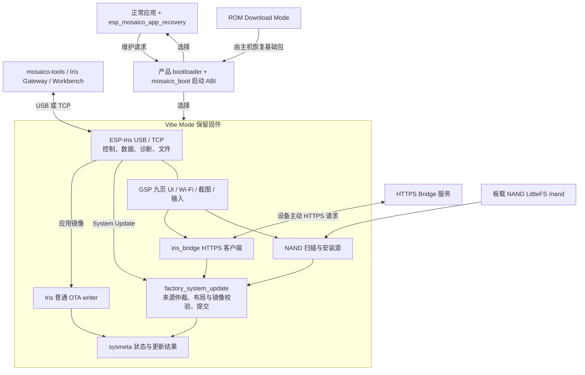

# ESP-Mosaico Vibe Mode 固件软件规格书

ESP-Mosaico Vibe Mode 是保留在设备 Flash 中的应用安装与维护固件，技术组件名为 `esp-mosaico-vibe-mode`。它在正常应用之外提供启动恢复、应用与系统更新、Wi-Fi 配网、网络下载、NAND 离线安装、文件访问和诊断界面，使设备在用户应用不可用时仍有可操作的维护入口。

本规格描述当前实现及其使用条件，按“问题—方法—系统架构—功能规格—应用场景”组织，面向产品、固件、主机工具、应用集成与测试人员。“应／不得”规定使用和验收条件；设备实测范围单独列在第 4.13 节，不将设计要求视作已完成验收。

| 项目 | 当前基线 |
| --- | --- |
| 文档修订 | 第 3 版，2026-10-10 |
| 源码基线 | `main`，`5f6f89d4a47098b567efa26ac09f2c8f9c027795` |
| 源码固件版本／评审基础包版本 | `0.2.1`／`0.2.1`；预编译包来自干净源码 `0bbf1c8`，验证范围见 `validation-0.2.1.md` |
| 目标硬件 | ESP-Mosaico，ESP32-S31，16 MiB 主 Flash，PSRAM、显示与触摸、板载 SPI NAND |
| SDK | Recovery 与普通应用固定使用提交 `188e3e55bb20505b5fa9dc49ee390bf42c58b4ee` |
| 产品契约 | `esp-mosaico/v2`，板型 `esp-mosaico` |
| 启动与布局 | Recovery ABI 2；布局版本 5；`mosaico-retained-test-2m-v2` |
| 更新制品 | 基础包 schema 3；System Update schema `esp-iris-system-update/0.2` |
| 范围 | 保留固件、产品 bootloader、公共启动 ABI、正常应用 Recovery 适配及设备更新后端 |

基线来源：[产品契约](../product_contract.json)、[公共 ABI](../include/mosaico_recovery_contract.h)、[固件配置](../firmware/vibe-mode/sdkconfig.recovery.defaults)、[评审包 manifest](../firmware/vibe-mode/prebuilt/recovery/manifest.json)。ESP-Iris、mosaico-tools 与 Vibe Mode 各自管理版本，不由工具版本推定设备固件版本。

## 1 问题

### 1.1 用户应用失效后缺少维护入口

用户应用可能无法启动、连续崩溃，或在启动 USB、Wi-Fi 和业务界面前失败。若安装与诊断能力全部位于该应用中，应用失效会同时失去更新入口。用户需要在不依赖应用正常运行的情况下重新安装固件，并保留定位故障所需的信息。

### 1.2 应用更新与系统更新的风险不同

修改业务代码通常只需替换应用镜像；更换工程可能还涉及资源、应用数据布局、分区表和 bootloader。若把这些操作当作同一种“烧录”，容易覆盖维护镜像、凭据、崩溃证据，或让应用与分区表不匹配。

### 1.3 不同现场需要不同安装方式

开发桌面需要 USB 和局域网安装；带屏设备需要独立完成配网和网页配对；离线现场需要从板载 NAND 选择安装包。这些入口应采用一致的组件校验与受保护分区策略，同时保留各自的授权和交互条件。

### 1.4 传输完成不能证明新固件可用

数据可能完整接收但写后校验失败，也可能镜像有效却启动失败。断线、设备重枚举和服务器回执丢失还会导致主机无法立即判断结果。系统需要区分接收、验证、提交、重启和健康确认，并能关联更新操作与目标设备。

### 1.5 产品维护与原生开发必须共存

产品需要固定维护入口，同时开发者仍需要标准 console、ESP-IDF 工程和调试接口。Vibe Mode、芯片 ROM 下载程序、普通应用必须清楚区分，避免把产品更新通道当作唯一硬件恢复手段。

### 1.6 维护固件本身也受资源和故障约束

Vibe Mode 固定槽仅 1.75 MiB，却承载显示、TLS、Wi-Fi、Iris 和多个更新来源。网络、显示或 NAND 故障不应轻易破坏 USB 维护能力；固件自身替换及 bootloader 更新又存在单副本擦写窗口，必须明确恢复边界。

## 2 方法

| 方法 | 当前实现 | 对应问题 |
| --- | --- | --- |
| 保留独立维护镜像 | `vibe_mode` 使用 `app/test` 分区，正常应用使用 `main_app` 的 `app/ota_0` | 应用损坏时保留安装与诊断环境 |
| 多入口启动选择 | GPIO7、持久化软件意图、基础安装标记、无有效应用回退；Iris 对已接入应用提供崩溃循环恢复 | 不依赖正常应用的一条维护入口 |
| 区分更新事务 | 普通 OTA、系统更新、Vibe 自更新、ROM 基础恢复分别处理 | 控制实际写入范围 |
| 复用系统更新后端 | Iris System Update、HTTPS Bridge、NAND 使用同一产品后端和来源所有权锁 | 统一布局、镜像、SHA-256 与写后校验 |
| 先提供维护服务 | Iris 更新服务在 UI、Wi-Fi 初始化之前启动；NAND 挂载失败允许降级 | 外设故障时保留 USB 路径 |
| 设备结果与主机验收分层 | 设备记录操作结果和启动意图；工具核验 Device ID、Boot ID、目标固件与健康事件 | 避免把上传成功作为安装成功 |
| 维护状态与应用状态分离 | 固定 `sysmeta` 保存维护状态，应用 `nvs` 位于可变区域 | 应用替换不必清空维护凭据 |
| PSRAM 承担大块存储 | UI、TLS、网络可迁移缓冲和受保护镜像暂存使用 PSRAM | 满足固定镜像与内部 RAM 约束 |

普通应用只集成进入 Vibe Mode、状态查询、系统清单和健康确认，不携带产品 OTA writer。应用更新期间业务会停止；Vibe Mode 接管设备后完成写入，再启动目标应用。

这些方法有明确边界：当前基础布局只有一个正常应用槽和一份维护镜像；系统更新后端接收未签名计划。SHA-256 用于完整性验证，TCP 配对和 HTTPS 用于接入或来源约束，均不等于发布者签名认证。设备不提供任意断电下的 A/B 无损回滚承诺。

## 3 系统架构

### 3.1 模块与职责

| 层次 | 所有者与实现 | 职责 |
| --- | --- | --- |
| 启动与 ABI | Recovery 的 `bootloader_components/main`、`components/esp_mosaico_boot`、公共头文件 | 按键、启动意图、维护镜像定位、OTA 启动选择、启动画面 |
| 正常应用适配 | `components/esp_mosaico_app_recovery` | 进入维护模式、健康确认、OTA 状态及只读 inventory；独立于 GSP 和业务 UI |
| 维护应用 | `firmware/vibe-mode/main` | Wi-Fi、GSP UI、NAND、产品控制 RPC、系统 inventory 和更新策略 |
| 远程下载 | `firmware/vibe-mode/components/iris_bridge` | 会话注册、配对、清单获取、授权、HTTPS 下载、取消和结果上报 |
| 通用设备协议 | 同仓库 `ESP-Iris/components/esp_iris` | 身份、控制与数据链路、RPC、任务、OTA 传输、文件、媒体、日志和崩溃记录 |
| 主机产品流程 | `mosaico-tools` | 构建、制包、设备选择、更新编排、ROM 执行器及更新后验收 |
| 网页与开发工具 | ESP-Iris Gateway、Workbench | 会话管理、远程画面、输入、文件与诊断操作 |

主机命令和网页是配套软件，不是 Vibe Mode 内置 Web 服务器。Bridge 是外部服务；协议实现位于本仓库不代表远程服务已完成配套部署。通用 Iris 契约见 [ESP-Iris 规格](../../ESP-Iris/docs/esp-iris-software-spec-zh.md)，主机行为见 [mosaico-tools 规格](../../mosaico-tools/docs/mosaico-tools-software-spec-zh.md)。

### 3.2 主 Flash 布局

以下为当前基础固件 `partitions.csv` 的实际布局，不含应用工程额外划分的资源区。

| 区域 | 类型／子类型 | 起始地址 | 大小 | 职责及更新规则 |
| --- | --- | ---: | ---: | --- |
| bootloader | 独立镜像 | `0x2000` | 窗口 `0x6000`，24 KiB | 产品启动选择；允许专门系统事务替换 |
| 分区表 | 独立区域 | `0x8000` | `0x1000`，4 KiB | 系统更新先验证，最终提交 |
| `otadata` | data/ota | `0x9000` | `0x2000`，8 KiB | OTA 选择及基础安装的一次性启动标记 |
| `phy_init` | data/phy | `0xb000` | `0x1000`，4 KiB | PHY 数据 |
| `sysmeta` | data/nvs | `0xc000` | `0x14000`，80 KiB | 维护凭据、启动意图、更新与崩溃状态 |
| `vibe_mode` | app/test | `0x20000` | `0x1c0000`，1.75 MiB | 保留 Vibe Mode；仅专门自更新或基础恢复替换 |
| `coredump` | data/coredump | `0x1e0000` | `0x20000`，128 KiB | 崩溃证据 |
| `nvs` | data/nvs | `0x200000` | `0x10000`，64 KiB | 应用数据，属于可变布局 |
| `main_app` | app/ota_0 | `0x210000` | `0xdf0000`，13.9375 MiB | 基础布局的唯一普通应用槽 |

系统固定前缀结束于 `0x200000`。产品契约要求当前表与目标表中的 `otadata`、`phy_init`、`sysmeta`、`vibe_mode`、`coredump` 五个分区保持名称、类型、子类型、地址、大小及 flags 一致。“布局不可变”不表示内容永远不写：启动逻辑会更新 otadata，维护服务会写 sysmeta，专用自更新会替换 Vibe 镜像。

`0x200000` 之后允许按目标布局调整应用与数据分区，例如缩小 `main_app` 并增加 `ui_apps`；基础包没有强制 `ui_apps` 分区。普通本地系统更新将应用映射到目标表的 `main_app/ota_0`；Bridge 另有按目标偏移校验可变应用分区的策略。NAND 是独立存储器，不占上述 16 MiB 地址空间。

`app/test` 使配套 IDF 默认普通应用烧录选择跳过维护分区，但不能阻止第三方完整烧录清单覆盖同一地址。保留维护能力依赖匹配 bootloader、分区表和制品，而非仅靠分区名称。

### 3.3 启动与服务初始化

1. ROM 根据硬件启动条件进入芯片下载程序，或加载二级 bootloader。GPIO61 是 ROM Download Mode 入口；GPIO7 是产品 bootloader 的 Vibe Mode 入口。
2. 产品 bootloader 停止软件／异常复位后可能残留的 USB DMA，显示启动画面，再读取分区表与维护请求。画面失败不阻断启动。
3. GPIO7 持续低电平达到默认 50 ms、基础安装标记或软件维护意图存在时，优先选择固定 test 分区。意图读取异常或未知值也优先尝试 Vibe；缺少意图键本身不算异常。
4. 其余情况沿用 IDF OTA 选择与镜像验证；无有效应用时尝试保留维护镜像。bootloader、分区表或维护镜像本身无效时，最终依赖 ROM 恢复。
5. Vibe `app_main` 先关闭音频功放，执行 Iris 启动探测，初始化 NVS/sysmeta，消费维护意图和安装标记，再处理 Bridge 的待启动记录。
6. 注册系统 inventory、系统更新后端、NAND 卷与控制 RPC，启动 Iris/OTA；随后创建 UI、注册输入、按配置处理 NAND 自动安装，最后启动 Wi-Fi 并报告健康。

USB 维护服务早于 UI 和网络启动，但不是所有初始化故障都能降级：关键 NVS、ABI 消费、核心服务注册等仍使用致命错误检查。NAND 挂载失败不格式化介质且允许继续；UI 或输入初始化失败保留已启动 USB 服务并不报告健康；Wi-Fi 启动失败允许离线维护并报告 Vibe 就绪。

实现依据：[主入口](../firmware/vibe-mode/main/main.c)、[基础分区表](../firmware/vibe-mode/partitions.csv)、[依赖版本](../firmware/vibe-mode/main/idf_component.yml)。

### 3.4 持久化状态与所有权

| 位置 | 内容 | 写入者与消费规则 |
| --- | --- | --- |
| eFuse 派生身份 | 稳定 Device ID | 由硬件 Base MAC 派生，不依赖 NVS 中的用户数据 |
| `sysmeta/mosaico_boot_v2/intent` | u32；`0x02000001` 为维护请求，0 为已消费 | 公共 boot API 写入；bootloader 只读；Vibe 消费 |
| otadata 偏移 32 | 16 字节 `MOSAICO-BOOT-02!` 安装标记 | 基础安装提供；Vibe 先提交 NVS 消费状态，再擦除 otadata 首扇区，保留第二扇区 |
| `sysmeta/esp_iris` | TCP 配对令牌、崩溃循环记录等 | Iris 管理；Vibe 活着不会自动清除普通应用失败记录 |
| `sysmeta/wifi` | 一组 SSID 与密码 | Vibe 配网成功取得 IP 后保存；Forget 清除该命名空间 |
| `sysmeta/iris_ota_demo` | `last_good`、`target` | OTA 适配记录目标；正常应用健康确认后记录当前地址并清除 target |
| `sysmeta/update/last_result` | 64 字节、版本 2，含 16 字节 operation ID 与结果 | 系统更新后端写入，Vibe 与正常应用 inventory 读取 |
| `sysmeta/iris_bridge_v2/pending_boot` | 版本 2、目标分区及目标分区表哈希 | Bridge 提交后保存；下次 Vibe 启动先消费，再核对表与目标后选择应用 |
| `coredump` | 异常现场 | IDF 崩溃机制写入，Iris 与主机工具负责读取和解码流程 |

操作结果记录表示设备端事务结果，不替代应用健康确认；它也不是任意断电阶段均可恢复的完整事务日志。正常应用原生烧录使用标准空白 otadata，不使用基础安装标记。

## 4 功能规格

### 4.1 模式切换与故障恢复

| 编号 | 功能与输入 | 实际行为及验收条件 |
| --- | --- | --- |
| REC-BOOT-01 | GPIO7 维护入口 | 在启动采样窗口内保持低电平达到去抖时间；选择固定 `vibe_mode/test`，不通过清空凭据进入维护模式 |
| REC-BOOT-02 | 软件进入维护 | 正常应用调用 `iris_ota_support_enter_recovery()` 或公开 RPC；验证维护镜像、标记计划重启、提交启动意图，默认延迟 500 ms 重启 |
| REC-BOOT-03 | 一次性意图 | bootloader 只读取，Vibe 消费；消费前断电可再次进入维护，消费后恢复普通启动选择 |
| REC-BOOT-04 | 无可启动应用 | 在产品 bootloader、分区表与维护镜像有效的前提下回到 Vibe，无需普通应用提供 USB 或 Wi-Fi 服务 |
| REC-BOOT-05 | 连续崩溃 | 已接入 Iris 的正常应用按镜像地址与 ELF 身份归因；默认连续 3 次 panic、看门狗或 CPU lockup 触发维护入口 |
| REC-BOOT-06 | 健康与重启区分 | 计划软件重启不作为上述崩溃；默认不把 brownout／power glitch 计入；普通应用稳定 30 秒或显式健康确认可清除其失败计数 |
| REC-BOOT-07 | 返回应用 | 公共启动 API 先验证并选择 OTA 分区，再清维护意图；调用者完成重启。Vibe UI 的 Home 是维护首页，不是“启动应用”按钮 |

崩溃循环计数依赖应用执行 Iris 启动探测及持久化记录，不保证识别任意第三方应用或所有发生在探测之前的故障。公共应用适配默认在 Iris 启动 3 秒后调用健康确认；这表示默认存活验收，不等于业务外设、联网及全部业务功能均已通过自检。需要业务验收的应用应自行定义健康条件。

实现依据：[bootloader](../firmware/vibe-mode/bootloader_components/main/bootloader_start.c)、[启动 API](../components/esp_mosaico_boot/mosaico_boot.c)、[应用适配](../components/esp_mosaico_app_recovery/iris_ota_support.c)、[Iris 崩溃策略](../../ESP-Iris/components/esp_iris/src/esp_iris_crash_recovery.c)。

### 4.2 设备连接与会话

| 编号 | 规格 |
| --- | --- |
| REC-LINK-01 | 默认启用 High-Speed USB 双 CDC：标准 console／控制接口与独立批量数据接口。UART 是固件配置的主 console；应用态 USB 不能补收它出现以前已由 UART 输出的启动日志 |
| REC-LINK-02 | Wi-Fi 联网后提供 Iris TCP；默认控制端口 19772、数据端口 19773，启用配对认证；通过 `_esp-iris._tcp` 发布 mDNS 信息 |
| REC-LINK-03 | 普通应用与 Vibe 使用同一 Device ID，每次启动产生新 Boot ID；控制与数据必须绑定当前设备、启动和会话，端口可见不等于已认证可用 |
| REC-LINK-04 | 数据链路可独立发现和握手；执行固件、文件或连续媒体传输仍需有效任务与会话授权 |
| REC-LINK-05 | UI 显示控制会话由 USB 或 TCP 占用；双传输可用不构成两个独立用户同时取得控制所有权的承诺 |
| REC-LINK-06 | 仅控制链路支持状态、RPC、日志及按需截图。固件和文件内容传输、连续镜像需要数据链路；控制 RPC 可触发从设备本地 NAND 读取安装包 |

TCP 配对令牌可在设备 Pairing 页查看。它与 Bridge 的设备配对码、HTTPS bearer token 是不同凭据，不得混用。Vibe 没有注册音频采集 provider，不能把 Iris 的通用媒体能力视作本固件已有录音功能。

### 4.3 普通应用更新

普通 App Update 用于替换应用代码，主机前置校验完整分区表及产品契约；需要改变布局或配套资源时使用 System Update。正常应用的编译门禁要求 `CONFIG_ESP_IRIS_OTA_DEFAULT_VIA_RECOVERY=y`，禁止携带 `CONFIG_ESP_IRIS_OTA=y` 的产品 OTA writer。

| 编号 | 规格 |
| --- | --- |
| REC-APP-01 | 正常应用 → Vibe → 接收目标应用 → 校验并选择目标 → 重启正常应用 → 主机验收；业务应用在维护期间停止运行 |
| REC-APP-02 | writer 运行于 test 分区，可替换单个 `ota_0`；若布局有其他 OTA 分区，目标选择会尝试避开已记录 last_good 的槽。基础布局仍只有一个应用槽 |
| REC-APP-03 | Iris OTA 校验声明长度、传输 SHA-256、镜像及应用描述信息；不得覆盖正在运行的维护分区，未通过验证不得提交为新的启动目标 |
| REC-APP-04 | 提交成功后固件主动安排约 1 秒后的重启，不依赖主机另发 RESTART；重启定时器在接受 OTA 前创建 |
| REC-APP-05 | `0x1200/1` 提供 mode、writer、运行／目标分区、last_good、target 及崩溃状态；正常应用健康确认后接受 pending 镜像并更新 last_good |
| REC-APP-06 | 主机成功条件为同一 Device ID、新 Boot ID、预期固件／ELF 身份、匹配契约及健康事件；传输 100% 或 Vibe 重新可达均不足以满足此条件 |

实现依据：[Vibe OTA 适配](../firmware/vibe-mode/main/recovery_ota_support.c)、[Iris OTA 实现](../../ESP-Iris/components/esp_iris/src/esp_iris_ota_service.inc)、[应用集成指南](../../mosaico-tools/docs/application-integration.md)。

### 4.4 系统更新与写入范围

| 更新类型 | 允许的内容 | 提交约束 |
| --- | --- | --- |
| 普通应用 OTA | 应用镜像 | 不改分区表、bootloader 或 Vibe |
| 本地 Iris／NAND 系统更新 | 分区表、普通应用、可变数据；可包含 bootloader | 非自更新事务要求分区表为首组件；bootloader 必须带匹配分区表 |
| Bridge `partitions` | 当前布局下的应用／数据 | 校验当前布局哈希，不写入新分区表 |
| Bridge `layout` | 目标布局与可变应用／数据 | 保留五个固定分区，目标可变应用必须提供镜像 |
| Bridge `system_update` | `.irisfw` 对应的完整系统计划 | 组件与会话文件逐项绑定；bootloader 能力由本地构建开关决定 |
| Vibe 自更新 | 一个 `recovery` 组件 | 不混入应用、数据、bootloader 或分区表；见第 4.5 节 |
| ROM 基础恢复 | bootloader、分区表、安装 otadata、Vibe | 由主机基础恢复执行器完成，不是运行中 Vibe 的网络写入流程 |

系统更新的实际次序为：

1. 为 operation ID 占用后端，解析 `esp-iris-system-update/0.2` 清单；拒绝零 operation ID、未知 schema、重复组件／文件、重叠镜像范围以及不支持的签名字段。
2. 校验 ESP32-S31 chip ID、实际 Flash 容量、可选最低维护版本、目标布局哈希、组件种类、大小和偏移；主机产品流程另校验 board、角色、产品契约和 ABI。
3. 接收并验证目标分区表，检查当前与目标五个固定分区，按目标表建立可写分区描述符。
4. 应用／数据直接流式写入目标地址：应用仅擦除镜像覆盖范围向 4 KiB 对齐的区域；提供镜像的数据分区擦除整个目标分区。接收结束后进行 SHA-256 读回校验，应用还执行镜像验证。
5. bootloader、分区表或专用 recovery 镜像先暂存在 PSRAM，检查结构、校验和及适用的镜像附加哈希。所有组件合格后才进入受保护区域提交。
6. 如存在 bootloader，先提交并验证；专用事务写入 recovery；分区表最后提交。受保护区域写前暂时关闭危险写保护，写后恢复并读回校验；内容已匹配则跳过擦写。
7. 选择下一次启动目标、保存操作结果并重启。Iris／NAND 系统更新默认安排约 1.8 秒延迟；Bridge 另走结果上报和重启流程。

**应用和数据并非等整个 bundle 收完才落盘。** 后续组件失败或取消不会恢复已经擦写的内容。目标分区未提供数据镜像时，不自动为它增加擦写；布局改变或地址被其他镜像复用时，也不保证原数据仍可使用。应用 NVS 位于可变区域，若清单显式提供其镜像，该分区会被替换。

后端的来源所有权锁覆盖 Iris System Update、Bridge 和 NAND，冲突来源返回忙／状态错误。普通 OTA 使用 Iris 的独立 OTA writer，没有接入该 `s_owner` 锁；当前不得将其描述为全部擦写通道的统一事务锁。产品操作应串行执行更新，普通 OTA 与其他更新交叉并发列为额外验收项。

状态可区分 prepared、receiving、committing、committed、failed、cancelled，并提供组件、接收字节数和结果。取消不能撤销已完成的 Flash 写入，不能将“请求取消”解释为“旧系统已恢复”。

实现依据：[系统更新后端](../firmware/vibe-mode/main/factory_system_update.c)、[系统更新接口](../firmware/vibe-mode/main/factory_system_update.h)。

### 4.5 Vibe Mode 自更新与基础恢复

| 编号 | 规格 |
| --- | --- |
| REC-SELF-01 | 自更新只能从运行中的固定 `vibe_mode/test` 发起，清单仅含一个 recovery 组件，地址为 `0x20000`，长度必须覆盖完整 `0x1c0000` 槽 |
| REC-SELF-02 | `target_layout_sha256` 在该事务中必须等于当前完整 4 KiB 分区表区域哈希；不通过自更新改变布局 |
| REC-SELF-03 | 镜像完整暂存于 PSRAM 后校验，尾部填充必须符合镜像规则；版本解析须有效、数值版本不得降低且主版本号一致，相同版本允许重装 |
| REC-SELF-04 | 当前构建启用 PSRAM XIP；擦写自身时保持必要代码可执行，写后校验并再次请求启动 Vibe；主机随后验证新启动与目标固件健康 |
| REC-SELF-05 | 单副本自身或 bootloader 擦写期间掉电可能使 Vibe 不能启动；此时使用 ROM Download Mode 安装完整基础包 |
| REC-SELF-06 | 基础包 manifest 列出镜像大小、偏移、哈希和初始启动目标；替换评审包前需完成制品、布局、哈希和设备验证，不默认全片擦除 |

版本数值检查不是防回滚硬件机制，也不能独立证明产品兼容。0.1 与 0.2 的协议、布局和更新制品不互通；跨代安装应采用第 5.7 节的成套迁移流程。

### 4.6 Wi-Fi 配网与局域网发现

| 编号 | 规格 |
| --- | --- |
| REC-WIFI-01 | 使用 STA 模式；扫描结果按 SSID 去重并过滤空 SSID，最多显示 16 项，包含信号强度和是否开放网络 |
| REC-WIFI-02 | 可通过设备触摸键盘或 USB 控制 RPC 提交 SSID／密码；SSID 为 1～32 字节，密码允许空、8～63 字节或 64 位十六进制 PSK |
| REC-WIFI-03 | 新凭据成功取得 IP 后存入 `sysmeta/wifi`；下次进入 Vibe 自动尝试连接，不覆盖普通应用的 Wi-Fi 策略 |
| REC-WIFI-04 | 连接／掉线重试受默认 15 秒窗口限制，失败状态可见；用户可重新选择网络或 Forget。初始化失败清理部分资源后允许重试 |
| REC-WIFI-05 | 联网后提供 IP、`mosaico-<身份后缀>.local` 和 Iris TCP 服务；Vibe 关闭 modem sleep，以维护响应为优先 |
| REC-WIFI-06 | 当前构建关闭 SoftAP 和企业 Wi-Fi；不提供热点门户或 EAP 身份／证书配网流程。网络不可用时 USB 维护仍可工作 |

实现依据：[网络管理](../firmware/vibe-mode/main/factory_network.c)、[控制 RPC](../firmware/vibe-mode/main/factory_recovery_control.c)。

### 4.7 Download Ideas 与 HTTPS Bridge

设备主动访问构建时配置的 HTTPS Origin，不开放本地 HTTP 更新服务器，也不提供任意 URL 下载 RPC。当前默认配置包含 Bridge Origin 和板型；生产部署仍需使用支持该契约的服务端。

| 编号 | 规格 |
| --- | --- |
| REC-BRIDGE-01 | 设备联网后可预取一次会话及配对码；预取不轮询安装任务。打开 Download Ideas 页后才激活工作，未联网时先引导配网 |
| REC-BRIDGE-02 | 配对页显示网站二维码、设备码和剩余时间；有效会话重复打开复用同一码。未配对会话本地期限为注册起约 600 秒；前台页可在到期后重新注册，后台预取到期结束 |
| REC-BRIDGE-03 | 使用证书验证的同一 HTTPS Origin，禁止自动重定向；设备认证 token 只留在工作上下文，不通过配对码 RPC 输出或日志打印 |
| REC-BRIDGE-04 | `/api/v1` 是服务 URL 前缀；注册响应必须为 `control_protocol=2`，产品 profile 为 `iris-s31-test-layout-v2`。不支持旧控制授权回退 |
| REC-BRIDGE-05 | 上报设备、启动、板型、维护版本、当前分区表、哈希和本地能力；可处理 partitions、layout、factory、system_update 四类计划 |
| REC-BRIDGE-06 | 执行前比较源分区表哈希，绑定组件描述与本会话文件；本地允许的自更新／系统更新／bootloader 能力不能由远程清单临时开启 |
| REC-BRIDGE-07 | `/authorize` 的 PRECHECK 响应给出有限写入期限；收完并验证后，还需 COMMITTING 的明确授权才提交受保护区域。进度上报不授予写权限 |
| REC-BRIDGE-08 | 接收阶段检查本地停止、远程取消与授权期限；独立查询任务可在大文件下载期间观察取消。COMMITTING 授权成功后的关键提交不再被晚到的本地停止撤销 |
| REC-BRIDGE-09 | 离开页面可暂停轮询，明确 Cancel 结束会话；未知的 PRECHECK 结果不自动重放安装。网络错误按有限注册重试及退避处理，不承诺组件断点续传 |
| REC-BRIDGE-10 | 提交后先保存本地结果，再限时约 2 秒等待结果上报；回执丢失不应使设备永远等候。先重启 Vibe，再按已保存的目标表哈希与分区记录转入应用 |

Bridge 的“完成”首先表示更新事务完成，不表示目标应用业务健康；应用启动验收仍应按产品条件完成。配套外部 0.2 服务联调尚在现有验证记录的未完成范围内。

实现依据：[Bridge worker](../firmware/vibe-mode/components/iris_bridge/iris_bridge.c)、[计划绑定检查](../firmware/vibe-mode/components/iris_bridge/system_plan.c)、[产品 Bridge 配置](../firmware/vibe-mode/main/factory_bridge.c)。

### 4.8 NAND 离线安装与文件服务

| 编号 | 规格 |
| --- | --- |
| REC-NAND-01 | 通过 SPI NAND、磨损均衡块设备和 LittleFS 挂载 `/nand`，读写打开；挂载失败不格式化、不自动扩容，不阻止 Iris USB 维护启动 |
| REC-NAND-02 | 挂载成功时注册文件卷 `nand`，覆盖整个 `/nand`；支持列目录、读取、写入、删除、建目录、重命名和原子替换，不仅限于更新目录 |
| REC-NAND-03 | 扫描支持 `/nand/system-update/manifest.json` 及其下一层 release 目录中的 manifest；最多展示 8 个候选，根目录枚举最多 64 项，不递归遍历更深目录 |
| REC-NAND-04 | 预检过滤格式错误、文件缺失、大小不符的包；界面显示 release、组件数、总字节数和 manifest 路径，用户确认后才安装 |
| REC-NAND-05 | RPC 可指定 `/nand` 下其他合法 manifest 路径；拒绝路径穿越、反斜杠、内嵌 NUL。组件文件必须与 manifest 同目录，文件名不得包含路径分隔符 |
| REC-NAND-06 | 安装时重新读取、校验清单与每个组件，按 4 KiB 缓冲流式读取并复用系统更新后端；目录扫描通过不等于镜像校验通过 |
| REC-NAND-07 | 文件上传先写同目录临时文件，经 SHA-256 验证后原子替换目标；多个组件不构成 bundle 级原子事务。安装期间不得通过文件服务修改该包 |
| REC-NAND-08 | 当前 recovery 配置启用 NAND 安装，但自动安装默认关闭；可通过配置指定启动时安装的固定路径。现有本地 UI 不提供 NAND 写入期间的专门取消流程 |

NAND 安装不要求互联网，也不要求主机把固件字节从 Iris 数据链路再次传入；使用文件服务上传包则需要可用数据链路。文件路径隔离和传输行为由 Iris 文件服务提供。

实现依据：[NAND 管理与安装](../firmware/vibe-mode/main/factory_nand_update.c)、[候选及状态定义](../firmware/vibe-mode/main/factory_nand_update.h)。

### 4.9 设备界面、截图和输入

UI 使用 ESP-GSP 1.4.0，设备与 PC 模拟器共享控制器；BSP 提供显示和触摸，当前 Vibe 不启动 LVGL。九个页面如下。

| 页面 | 功能 |
| --- | --- |
| Home | 显示 USB／网络状态、地址，进入配网、Pairing、Download Ideas、NAND update |
| Wi-Fi | 网络列表、信号、连接状态、重新扫描、忘记网络 |
| Password | 原生键盘、大小写／符号、删除、确认、密码显示切换；输入最多 64 字节，离页清理 UI 密码 |
| Pairing | 显示局域网 TCP 地址与配对令牌 |
| Bridge | 网站二维码、设备码、期限、等待／配对状态与取消 |
| NAND | 候选包列表、扫描状态、无包／错误信息与重新扫描 |
| Confirm | 确认 NAND 包的 release、容量、组件数和路径 |
| Update | 显示来源、组件、接收进度、传输速率以及校验／提交阶段 |
| Result | 显示失败或终态并返回维护首页；接收完成后的提交失败仍显示失败 |

页面资源、字形和图标嵌入维护镜像；GSPB 构建时压缩，启动解压至 PSRAM，因此 UI 不依赖用户应用资源区。当前只使用预烘焙字形，关闭运行时 JPEG 解码。状态由快照汇总，在渲染上下文更新；外部打开下载页通过调度接口交给 UI。

画面输出为 480×480 RGB565，全帧 460,800 字节。支持按需截图和连续镜像；按需截图可走控制链路，连续镜像走数据链路。镜像占用期间的控制截图可返回忙，Workbench 可复用镜像帧完成截图。捕获等待完整已绘制画面，不把尚未绘制像素当作有效首帧。

USB 会话可通过 `0x1001/1` 注入触摸按下、移动、抬起；使用 12 字节小端 pointer 契约并检查坐标范围。该 RPC 拒绝 TCP，不能把局域网画面查看等同于远程触控授权。触摸注入不等于通用键盘、鼠标或任意系统输入服务。

实现依据：[UI 控制器](../firmware/vibe-mode/main/vibe_ui.c)、[服务适配](../firmware/vibe-mode/main/factory_ui.c)、[屏幕 provider](../firmware/vibe-mode/main/iris_screen_mirror.c)、[输入权限](../firmware/vibe-mode/main/factory_ui_input.c)。

### 4.10 系统清单、日志与故障诊断

系统 inventory 返回布局版本、bootloader 区域和完整分区表区域的 SHA-256，以及可用的最近操作 ID／结果；与 Iris 实时身份、固件描述及分区信息共同供主机验证。bootloader 区域哈希覆盖 `0x2000` 至 `0x8000`，不是仅对未填充的 bootloader BIN 计算。

当前启用 Core Dump 到 Flash、完整 ELF SHA 标识、Iris 日志环及任务内存观测。状态可查询失败镜像、崩溃计数与恢复待处理标志；主机解码 Core Dump 时必须使用匹配 ELF。普通更新不默认清空 Core Dump；接受新固件可重置崩溃循环状态，这与删除原始故障证据不同。

Bridge 日志记录组件实际接收字节、总耗时、读取和后端写入耗时、最长单次读取及栈余量。UI 速率表示 writer 接受的负载字节速率；总安装时间还包含连接、擦除、验证、提交和重启，不能据此宣称恒定网络吞吐。

原生 console、硬件复位、日志跟随及 ELF 解析由 IDF、Iris 和主机共同提供。当前 Vibe 配置保留 UART 主 console；High-Speed USB 重枚举期间的日志空窗需要如实记录，不能补造早期日志。

### 4.11 对外接口与集成约束

| 接口 | 作用 | 限制 |
| --- | --- | --- |
| `0x1200/1` | 正常应用／Vibe OTA 状态 | 空请求，JSON 状态结果 |
| `0x1200/2` | 正常应用健康确认 | 注册于应用适配；不是 Vibe 自更新授权 |
| `0x7fff/2` | 正常应用进入 Vibe | 使用公开 Recovery 服务标识；持久化意图后重启 |
| `0x1201/2` | 从 NAND manifest 路径开始系统更新 | 配置启用后注册；遵循 Iris 会话访问控制和 `/nand` 路径限制 |
| `0x1202/1` | 设置 Vibe Wi-Fi | 仅 USB；载荷为长度与 SSID／密码字节 |
| `0x1202/2` | 查询网络状态 | 仅 USB；返回状态、连接标志、IP、hostname、错误 |
| `0x1202/4` | 打开 Bridge 页面 | 仅 USB；打开并返回状态，重复调用复用有效会话 |
| `0x1202/5` | 查询 Bridge 状态 | 仅 USB；返回码和期限等，不返回认证 token |
| `0x1001/1` | UI pointer 输入 | 仅 USB；12 字节消息和屏幕坐标约束 |
| Iris OTA、System Inventory、System Update、文件与媒体协议 | 固件、清单、诊断、文件和画面传输 | 遵循 Iris 0.2 的帧、会话、任务和数据绑定契约 |

旧本地 HTTP 授权方法 `0x1202/3` 已移除；不提供旧 URL 更新 RPC、`http-update-code` 或 `--manifest-url` 兼容入口。固件工程位于 `esp-mosaico-vibe-mode/firmware/vibe-mode`，CMake 工程名为 `vibe-mode`；`recover` 命令和 `recovery` 角色名称保留，用户界面统一使用 Vibe Mode。

普通应用通过公共 `esp_mosaico_app_recovery` 和 `esp_mosaico_boot` 接入，并在 `project()` 前包含公共 CMake 集成。Mosaico 产品的 Vibe、普通应用与 bootloader 要求有效 QIO 配置；ROM 加载阶段由 SDK 生成的 DIO 镜像参数不改变产品运行时的 QIO 要求。

所有实际设备操作应通过消费工作区的 `mosaico.py` launcher 执行。以下为已存在的产品入口，参数与包格式以对应命令帮助为准：`recover`、`iris app-update`、`iris system-update`、`iris test enter-recovery`、`iris test recovery-wifi`、`iris test bridge-code`。构建器、Gateway 和网页接口不属于固件 ABI。

### 4.12 容量、安全与可靠性约束

| 项目 | 当前规格或边界 |
| --- | --- |
| 维护镜像容量 | 固定 1,835,008 字节；评审 BIN 为 1,782,864 字节，余量 52,144 字节。当前源码重建的体积必须另行测量 |
| bootloader 容量 | 固定 24 KiB 窗口；评审 BIN 为 21,984 字节 |
| Iris 更新载荷 | 当前 OTA 与 System Update 的组件数据块配置均为 3,968 字节 |
| Iris System Update 清单 | 当前协议配置最多 8 个组件、manifest 最多 3,072 字节 |
| NAND 清单 | 文件读取上限同样为 3,072 字节；UI 候选预检最多接受 8 个组件。直接路径安装仍受文件上限及后端校验约束 |
| 系统后端解析容量 | 通用来源的 manifest 字节入口最多 32 KiB，后端计划最多 96 组件；这是内部容量，不能覆盖 Iris／NAND 入口更小的实际限制。Bridge 完整系统计划另受其响应与封装限制 |
| 内存 | 默认普通分配优先 PSRAM，保留 64 KiB 内部池；DMA、必要任务栈和控制块仍使用内部 RAM；app_main 栈 20 KiB |
| 认证与完整性 | TCP 配对、HTTPS 证书和会话授权、组件 SHA-256、镜像及写后校验分别生效；系统后端不验证发布密钥签名，含签名的计划被拒绝 |
| 安全配置适用性 | 评审包关闭 Secure Boot 与 Flash Encryption；完整系统后端不适用于 Flash Encryption 构建，不宣称已验收加密量产更新 |
| 故障后可用性 | UI、网络、NAND 各有降级处理，但关键存储／核心服务失败不保证继续启动；损坏的 bootloader、布局或 Vibe 可能需要 ROM |
| 断电一致性 | 应用／数据为原地流式写入；bootloader、表和 Vibe 为单副本关键提交。无全 bundle 回滚、无 A/B 旧应用保留保证 |
| 并发 | 系统更新来源互斥已实现；普通 OTA 与系统来源的跨路径全局互斥不作保证，按单任务使用 |
| 性能承诺 | 不设未经设备验收的启动时间、OTA 吞吐、镜像帧率或“所有负载”内存上界 |

52,144 字节余量仅由评审 manifest 的槽大小减 BIN 长度所得。验证记录另有后续源码构建的 52,176 字节余量，两者对应不同制品，不能混用。普通应用 Iris 的内部 RAM 专项预算也不能当作完整 Vibe 固件的内存预算。

### 4.13 验收与当前覆盖范围

| 验收项目 | 通过条件 | 当前证据与范围 |
| --- | --- | --- |
| 启动／基础恢复 | 同一硬件身份；有效 Vibe；GPIO7 和软件切换正确；安装标记正常消费 | 0.2 记录含 S31 ROM 基础安装、物理 GPIO7 及应用往返；启动意图／选择器有 C host 测试 |
| App Update／System Update | 清单、范围、镜像与读回校验正确；重启后目标固件和健康符合预期 | 0.2 S31 设备流程已记录通过 |
| Vibe 自更新 | 专用槽包及版本检查；新 Boot ID、目标 ELF、健康事件 | 评审制品对应设备流程已记录通过；不能外推任意掉电安全 |
| 连续崩溃与诊断 | 计划重启不误判；失败可保存、定位并恢复 | 记录含计划重启、断言、非法访问、任务看门狗、启动循环五项矩阵；四类故障有 Core Dump 与匹配 ELF |
| 软件切换稳定性 | 多次应用 → Vibe → 更新 → 健康应用 | 历史记录 20 次通过，但使用独立压力构建，不是评审 ELF 的 20 次实测 |
| 网络与画面 | Wi-Fi 凭据跨重启、TCP 认证、截图与镜像有效 | 0.2 S31 记录覆盖联网和媒体；部分 TCP／文件／OTA 测试来自配套夹具，应按制品区分 |
| GSP UI | 九页导航、键盘、列表、二维码、进度与终态 | 现有原生模拟测试覆盖；模拟服务不代替真实更新 |
| Bridge | 配套服务注册、配对、下载、授权、取消、提交与重启 | 源码和 host 模拟覆盖；外部 0.2 服务完整联调仍未完成 |
| NAND 安装 | 完整包扫描、确认、流式读写、重启和健康 | 已记录真机挂载、空目录、Rescan；完整 NAND 包安装未作通过结论 |
| 故障／性能扩展 | 完整断电、跨路径并发、低内存、实际网络与文件混合负载 | 不作为当前已验收能力；新增配置需独立测试 |
| 原生开发 | 维护入口保留、console 可读、复位／调试可用 | 单独 monitor 已记录通过；HS `flash monitor` 首次打开有重枚举时序限制；JTAG/OpenOCD 未完成本轮设备验收 |

本规格修订时，从 `esp-mosaico-vibe-mode/tests` 运行已有专项测试：`test_mosaico_boot.py`、`test_bridge_host.py`、`test_bridge_system_plan.py`、`test_recovery_resilience.py`、`test_retained_recovery_contract.py`、`test_product_contract.py`、`test_prebuilt_recovery_release.py`、`test_recovery_version_host.py`、`test_vibe_transfer_host.py`、`test_boot_splash_host.py`，结果为 **33 passed，24 subtests passed**。本次为文档与源码核对，没有重新构建或写入设备，也没有更新评审二进制。

历史实测、制品哈希和未完成项目以 [0.2 验证记录](validation-0.2.md)为准。发布验收应记录源码与 SDK revision、实际配置、BIN／ELF／分区表哈希、写入范围、设备身份、Boot ID、原始日志及 operation ID；host 测试通过不能替代断电、GPIO、USB、联网和 NAND 的真机验证。

## 5 应用场景

### 5.1 开发者通过 USB 迭代应用

前提是设备已安装匹配的 0.2 基础固件，应用接入公共 Recovery 适配。开发者在消费工作区使用 `mosaico.py iris app-update`；工具确认身份和完整布局，令应用进入 Vibe，传输并校验镜像，等待设备主动重启，再确认目标固件与健康状态。

适用于只变更业务代码的迭代。若资源或分区变化，改走 System Update；不能仅替换应用 BIN 来掩盖资源不匹配。

### 5.2 从现有应用切换到另一套产品应用

新应用带有不同资源或可变分区布局时，制作匹配的系统更新包。Vibe 校验当前固定系统前缀和目标表，先写应用／数据，最后提交表并启动目标。Wi-Fi 和维护状态保存在固定 sysmeta；目标清单显式包含的应用数据分区按清单替换。

适用于应用换装和配套资源发布。未提供的数据镜像不会自动擦除，但跨布局数据是否仍有意义由目标应用负责，不等同于数据迁移服务。

### 5.3 用户在设备屏幕上下载应用

设备进入 Vibe 后，用户点击 Download Ideas。未联网则先配网；联网后设备显示网站二维码和配对码，用户在配套网页完成配对与安装选择。设备按 HTTPS Bridge 的预检授权、下载校验和提交授权完成更新。

适用于不接开发电脑的应用分发。该场景依赖支持 control protocol 2 的 Bridge 服务，服务端联调与部署验收是上线前置条件。

### 5.4 无互联网现场从 NAND 安装

提前将完整解包 bundle 放入 `/nand/system-update` 或其 release 子目录。用户进入 NAND update、扫描、查看包信息并确认安装；设备从本地文件逐块读取，再经系统后端完成写入和重启。

适用于展示、教学和离线维护。准备介质时要保证 manifest 与组件来自同一包，安装期间保持文件不变；损坏或无法挂载的 NAND 不会被固件自动格式化。现有版本的完整 NAND 真机安装仍需补齐验收。

### 5.5 应用崩溃后的诊断与重新安装

已集成应用连续异常达到阈值时自动转入 Vibe，或用户在重启时使用 GPIO7 进入。维护人员先通过 Iris／主机工具提取日志、崩溃状态和 Core Dump，使用匹配 ELF 定位，再安装修复应用。修复后确认新固件身份和健康状态，而不是仅确认 USB 端口重新出现。

适用于用户代码导致的反复重启。若应用未接入 Iris、失败早于启动探测，仍可使用物理维护入口；若产品 bootloader 或 Vibe 已损坏，则转 ROM 基础恢复。

### 5.6 维护固件升级与第三方固件回归

同契约维护功能升级使用专用 Vibe 自更新包，完成整槽校验和新固件健康验收。维护镜像损坏、关键系统区写入中断，或第三方工程覆盖产品布局后，进入 GPIO61 对应的 ROM Download Mode，由消费工作区 `mosaico.py recover` 安装完整匹配基础包。

适用于售后恢复和开发环境切换。基础恢复不会自动重建被第三方覆盖的业务数据，也不默认全片擦除；应根据完整镜像清单确认实际写入范围。运行中的 Vibe 和 ROM 下载程序具有不同接口，不能用 Iris 服务是否可达判断 ROM 是否可用。

### 5.7 从 0.1 成套迁移到 0.2

1. 在旧环境导出必要业务数据、日志和 Core Dump，记录硬件身份，随后释放旧连接。
2. 准备配套 0.2 工具、bootloader、分区表、安装 otadata 和 Vibe 镜像，核对全部哈希和写入范围。
3. 通过 ROM 与 `mosaico.py recover` 安装，避免依赖 0.2 主机和 0.1 固件直接通信。
4. 确认同一硬件身份、新 Boot ID、Vibe 版本、ABI 2、布局版本 5 及维护能力；按需重新建立配对。
5. 将应用迁移到公共集成入口，按新契约完整重建应用与资源，安装后验证普通应用 → Vibe → 普通应用闭环。

0.2 不自动解释旧协议或转换旧更新包，也不因迁移而默认清空 sysmeta。具体步骤及原生工程边界见 [0.2 启动契约与迁移](migration-0.2.md)；评审包和当前源码的适用范围见 [组件说明](../README.md)及 [验证记录](validation-0.2.md)。
