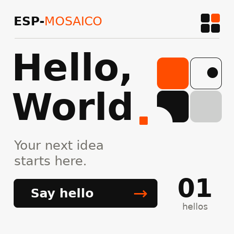
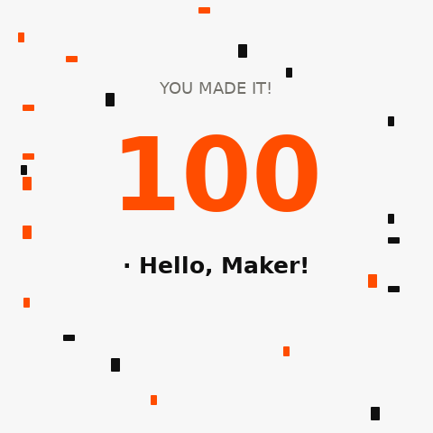

# Hello World implementation and validation (historical record, 2026-09-19)

This page preserves pre-migration versions and validation evidence; see [Hello World](../../templates/hello_world/README.md) for the current template.
The current product pins ESP-GSP 1.5.1; the 1.2.0 results below describe only the environment validated at that time.

Following the approved concept, the single Hello World application was consolidated in
`projects/hello_world` (former workspace path). The old LVGL Hello World
was replaced by GSP and the separate `projects/gsp_hello` directory removed.

## Native rendering

These are actual 480×480 RGB565 screenshots from the ESP-GSP 1.2.0 simulator running the shared C backend,
not concepts or browser redraws. They use native text, containers, buttons and text bindings, with bundled
DejaVu Sans regular/bold fonts and retained licenses.

Tapping either Say hello text or its arrow increments the counter. A hold counts once; tapping outside the button does nothing.
The 100th tap displays "100 · Hello, Maker!" with orange/black confetti, returning to 00 after about 3 seconds.
Additional taps during celebration are ignored; restarting resets the counter. Bottom explanatory text was removed.
Button corners use 8 px radii, matching GSP 1.2.0's fixed pressed-highlight radius to prevent overflow. The counter demonstrates touch interaction, not system load.

## Project migration

- Retained the separate `ui_apps` resource partition, fixed Recovery partition prefix and ESP-Iris screen mirroring.
- Updated the default simulator entry, project-generation descriptor, test-firmware references, documentation and CI; removed duplicate firmware CI jobs.
- The project generator copies 22 source/resource files, including the PC backend, scenes and fonts, and relocates the GSP compiler and
  resource-packer paths. Creation in nested directories was validated.
- Pinned ESP-GSP 1.2.0; the application retained ESP-IDF >=6.2.

## Validation results

- Native C backend interaction test passed: 101 greetings covering text/arrow taps, outside taps, holds,
  button-corner presses, the 100-tap Easter egg, changing confetti frames, ignored celebration taps, automatic reset and clean shutdown.
  That workspace interaction script has since been removed; this entry preserves the historical result.
- Related regressions: 33 passed, 29 subtests passed. Generator tests rerun after final template documentation changes: 7 passed.
- Hello World firmware built for ESP32-S31 with zero warnings.
- The template-generated nested `init_smoke` project built completely with zero warnings.
- Used local ESP-IDF `v6.2-dev-2221-g7b9cc1ac79f-dirty` and Python 3.12.3, preserving existing environment changes.

Device flashing was completed; see the device validation below. Physical-screen touch feel remains for the user to assess.
Migration from the old LVGL firmware should use `python mosaico.py iris system-update --project projects/hello_world`
to install application, partition table and `ui_apps` together; app-update alone cannot update these UI resources.

## Complete local evidence

- Raw Hello World build log: `projects/hello_world/.codex-runs/idf-low-noise-build/20260919-215143-build-1157578/raw.log` (pre-migration local path)
- Raw generated-project build log: `tests/firmware/build-hello-world-template/init_smoke/.codex-runs/idf-low-noise-build/20260919-211943-build-1126853/raw.log` (pre-migration local path)
- Native interaction result: `.agents/validation/hello-world-migration/build-refinement/celebration/result.json` (pre-migration local path)
- Native backend log: `.agents/validation/hello-world-migration/build-refinement/celebration/backend.log` (pre-migration local path)

Build/runtime evidence remains in local ignored directories; this page's PNGs are rendering evidence retained with source.

## Device validation (2026-09-19)

Installed through `mosaico.py iris system-update` onto the device at USB `1-1`:

- MAC：`30:ed:a0:f4:51:8e`。
- Device ID：`4553502d49524953010030eda0f4518e`。
- Update operation: `daa45966-91bc-42f6-bea0-f338b1e1ad31`, status succeeded, validated, healthy.
- Boot IDs on the same device across normal→Recovery→normal:
  `1948257783875663994` → `1653815596140587364` → `6627965944312267903`。
- Firmware ELF SHA-256: `a9d28868f9a50464902a44d5cbdfb0cad9533bc8604391f0d6242058872e0ceb`, matching the device.
- UI resources SHA-256: `a4ab24e0a8409015c1a3b170d380d14ed85bb02ad45cd831dd8dab78200f8313`.
- The first device screenshot exposed different child-container clipping between simulator and device. Decorative circles were moved to the root level,
  with the heading's orange square drawn above them to remove occlusion. The fix passed the 101-interaction native test and device System Update again.
- This refinement was reflashed: home matches the native simulator pixel for pixel; the 100-tap Easter egg, animation and timed reset passed
  shared native C backend tests. Physical-screen 100-tap behavior remains for user validation.
- Gateway API results used by CLI and Workbench returned the same Device ID, Boot ID and update record.
- The other USB device was neither claimed nor updated. Product commands automatically preserved available historical core dumps before the operation.

Structured device results: `.agents/validation/hello-world-migration/build-refinement/summary.json` (pre-migration local path) ·
Complete update operation: `.agents/validation/hello-world-migration/build-refinement/system-update-operation.json` (pre-migration local path) ·
Raw device logs: `.agents/validation/hello-world-migration/build-refinement/device-logs.txt` (pre-migration local path)
