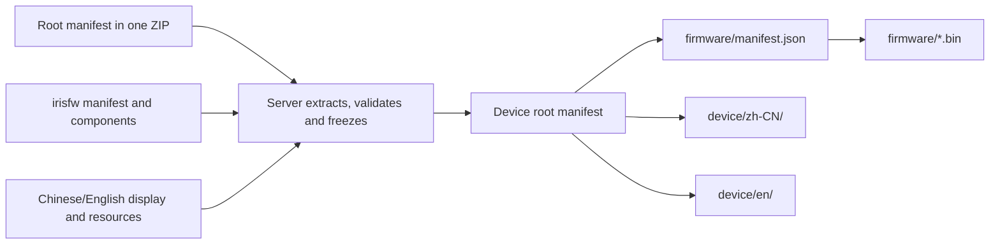

# Mosaico Ideas file-release and device-download protocol draft

Updated 2026-10-14. For Mosaico Ideas server, mosaico-tools and ESP-Mosaico Vibe Mode integration developers.

Upload **one ZIP** containing a complete immutable file collection described by root `manifest.json`, with firmware still in `.irisfw`. Devices **GET the manifest endpoint directly for a complete single-response preview**: root, firmware manifest and current-language display/fonts/icon. After confirmation, download remaining references while retaining directory structure; complete Chinese/English resources permit offline switching. **Vibe Mode self-update is separate and outside this protocol.**

**This draft records agreed initial rules; CLI, device implementation and a local test server are available.** File validation, capacities/fields, compatible-release selection, APIs, author inputs and language behavior define implementation/acceptance. Timeouts use configurable defaults below. Production integration, capacity extremes and hardware endurance require separate acceptance; the test server is not evidence of production deployment.

See [test server and acceptance](testing.md) for runnable steps and [hardware records](acceptance.md) for completed end-to-end results.

## Agreed scope and implementation boundaries

| Topic | Goal | Implementation/boundary |
| --- | --- | --- |
| Upload | One ZIP, completely described with each file declared once | project package/validate/upload implemented; local server accepts one ZIP |
| Device download | Capability/language GET returns latest-compatible complete preview, preserving firmware/ and device/<locale>/ without resolve | device-release/1 parsing, directories and pinned snapshots implemented |
| Vibe self-update | Separate, undefined here | Protocol/schemas accept ordinary Ideas only, not system-firmware writes |
| Formats | Only new formats defined here; no V0.1 | No old readers, converters, migration matrices or compatibility-test branches |
| Chinese/English | System UI and Idea names/descriptions; initial Chinese, offline/persisted switching, name-glyph lists | Built-in bilingual strings/fonts, NVS preferences and offline list/detail glyph reuse |
| File acceptance | Encoding/pixels, cover count/size, ZIP totals, counts and fields below | Tools/server share content validators; device independently checks downloads |
| Implementation | CLI, test server, device and tests | Recovery ABI/reviewed binaries stable; candidates accepted separately |

Product baseline: 0.2, Recovery ABI 2, layout 5. Recovery paths, commands and ABI names stay stable; UI says Vibe Mode, chip downloader says ROM Download Mode.

Tools generate frozen collections, hashes and resources. Servers own identity, permissions, transactions, validation, immutable storage and release indices. Devices own parsing, independent safety checks, directories, bilingual UI and confirmed ordinary-app installation.

Upload creates drafts only, without devices, review submission or publication. Accounts, ownership, review state, visible-release pointers and statistics are server state; database titles/indices and device manifests derive from frozen content.

## Avoid duplication: One description per layer

| Description | Sole responsibility | Fields not duplicated |
| --- | --- | --- |
| ZIP root manifest.json | Website metadata, irisfw file and display collection | No copied firmware version, chip, components or display text |
| irisfw manifest.json | Firmware version, hardware, components and write plan | Preserved on download, not repeated in an outer component table |
| Per-language display.json | Name, description, fonts, icon and glyph layout | Root does not copy name/description/locale/fonts/icon |
| Device root manifest.json | Release identity, author display name, profile, firmware-manifest reference and bilingual files | No embedded system_manifest, repeated firmware version or global files table |
| Manifest HTTP response | multipart/related carries root/full preview dependencies; JSON remains original root; ETag binds response body | No editable descriptors, duplicate business fields, temporary URLs or preparsing requests |
| Local index/update journal | Lookup caches, selection, install/boot results | Rebuildable or independent state, never another editable content source |

Firmware manifest components transitively define firmware files. Dependency depth is fixed: root → firmware manifest/display → components/resources. Arbitrary recursive manifests, scripts and remote dependencies are unsupported. The complete collection is this closure; missing references prohibit commit.



Upload paths, NAND-relative paths and network URLs differ. Root path identifies collection placement; hashes derive URLs. The same icon may appear in each language directory with object-store deduplication, while devices materialize ordinary files in both.

## Identity, versions and immutability

| Field/version | Meaning |
| --- | --- |
| application.id / code | Server-assigned stable identity/six-digit code; preserve leading zeros, never recycle to another app |
| revision_id | Server draft-content snapshot identity |
| release_id | Immutable device-release identity; compare equality only, never lexical ordering |
| Firmware release | Sole source: irisfw manifest.release. Text/icon changes may reuse firmware versions with a new release_id |
| manifest_sha256 | Hash of specified original manifest bytes, sensitive to indentation/newlines |
| File sha256 | Hash of actual raw bytes, not object-store ETag |
| Product baseline | 0.2, ABI 2, layout 5; validated separately from JSON formats |
| release/1, device-release/1, display/1, system-update/0.2 | Independent content formats, not product/firmware versions |

The new device format is `mosaico-ideas/device-release/1`, distinct from existing `mosaico-ideas/download/1` and temporary historical `/2` tests. New manifest GET paths accept only these schemas. Unknown/invalid content fails directly, without legacy parsing, conversion or fallback.

Upload manifests contain no application/release IDs. Requests bind targets and completion receipts associate identity. Device application.id/release_id are 1–64 ASCII characters, starting with a letter/digit and continuing with letters, digits, `.`, `_`, `-`. Website title and device name.text serve different purposes and may differ.

archive.size/sha256 pin uploaded ZIP bytes; accepted records cannot replace their ZIP/files. Every later content change creates another snapshot. A release contains zh-CN/en sharing release_id/root hash. Language selection neither creates another package nor updates firmware. Changing root/files under one release_id violates the protocol.

Original ZIPs, upload manifests, expanded firmware members and device roots are separate immutable objects. archive_sha256 covers ZIP bytes; manifest_sha256 covers its root, and neither substitutes for the other. Recompression may change ZIP hashes without changing files; explicit resends still verify original ZIP bytes. Servers record source hashes/generator versions without rewriting originals or modifying manifests on request.

## Files, paths and capacities

The uniform file descriptor has three fields:

```json
{"path":"device/zh-CN/display.json","size":2048,"sha256":"4444444444444444444444444444444444444444444444444444444444444444"}
```

Field placement and validated content determine purpose; add no role, media_type or second global files table. size is positive integer bytes; sha256 is 64 lowercase hex characters. JSON/Markdown use BOM-free UTF-8; reject duplicate keys, NUL, nonfinite numbers and trailing data. JSON depth ≤12, display ≤8; booleans are not integers. Upload/publication reject unknown fields. Devices ignore unknown published fields while checking all used fields, skip presentations outside zh-CN/en, fall back to zh-CN for unsupported default_locale, and accept ≤8 assets per language without requiring all to be display-referenced. Character bounds count decoded Unicode code points, not UTF-16 units/glyphs; UTF-8 byte bounds also apply. Reject unpaired surrogates and never silently normalize frozen content.

Upload and new device collections share path rules:

- Root-relative `/` paths, 1–192 ASCII bytes, at most 4 segments of 1–64 bytes.
- Each segment starts with a letter/digit; remaining characters are letters, digits, `-`, `_`, `.`.
- No absolute paths, empty or `.`/`..` segments, backslashes, URLs, percent encoding, queries or fragments.
- Paths are unique. Upload/publication also reject ASCII case-fold conflicts; device LittleFS is case-sensitive and rejects exact duplicates. File/directory prefix conflicts are prohibited.
- Root manifest.json is reserved and never its own dependency. Upload integrity uses whole-ZIP hash/server extraction checks; download trusts HTTPS/TLS and separately hashes original multipart root bytes as root_sha256.
- Regular files only, no symbolic/hard links or special files. Writing, recursive cleanup and recovery must not follow links or escape the release root.

Device roots reference fixed `firmware/manifest.json`; its component file basenames resolve under firmware/, obey Iris filename rules and cannot be manifest.json. Display font/icon basenames resolve beside display. **Different languages may share basenames**; no global basename deduplication against other languages/firmware.

Initial acceptance limits follow. Enforce both individual and aggregate bounds on actual bytes, not compressed irisfw size or declarations alone. 1 KiB=1024 bytes, 1 MiB=1048576 bytes.

| Object | Limit | Status |
| --- | --- | --- |
| Upload root | 64 KiB | Confirmed |
| Raw upload ZIP | ≤100 MiB | Confirmed |
| Outer uncompressed collection | ≤100 MiB including root | Confirmed; inner irisfw checked separately |
| Files/ZIP entries | ≤164 regular files including root; ≤512 ZIP entries including optional directories | Confirmed |
| irisfw | 32 MiB; inner expanded total also ≤32 MiB, ≤16 members | Existing firmware constraints |
| Device root | 64 KiB | Confirmed |
| Firmware-installation manifest | 3072 raw bytes | Existing installer constraints |
| Complete device set | Root, firmware manifest and both languages; ≤32 MiB, ≤32 files | Confirmed |
| Ordinary firmware components | 2–8, each ≤16 MiB and fitting target partition | Existing installer constraints |
| Per-language display set | display/fonts/icon ≤1 MiB; bilingual ≤2 MiB | Confirmed; peak memory requires hardware validation |
| Individual display | 32 KiB | Existing display constraints |
| Device icon | Fixed 64×64 px RGBA PNG, ≤64 KiB | Confirmed |

New validators enforce these limits, but extreme capacity still needs hardware stress tests. A 64 KiB JSON tree, strings and indices consume extra RAM; file bounds are not memory budgets. NAND must also accommodate filesystem overhead and coexisting current/incoming/previous generations.

### Confirmed file acceptance rules

Agreed 2026-10-14 for new ZIPs and derived device content:

| Object/process | Requirement | Validator |
| --- | --- | --- |
| Finished device icon | Fixed 64×64, 8-bit/channel RGBA PNG, non-interlaced/non-animated, 1–65536 bytes; transparency allowed | Tools, server and device reading/rendering |
| Website covers | 0–9 single-frame JPEG/PNG/GIF/WebP, 1–4096 px per dimension, 1 byte–10 MiB each; array order is display order | Tools/server |
| Other website images | Same format/frame/pixel/10 MiB limits for body resources/attachments | Tools/server |
| Author icon source | Single-frame JPEG/PNG/GIF/WebP, 1–4096 px, 1 byte–10 MiB | Generator prechecks and bounded decoding |
| Upload ZIP | Raw ≤100 MiB; outer regular-file total including root ≤100 MiB | Tool self-check/server reception/bounded extraction |
| Icon conversion | Before manifest hashing/ZIP; prebuilt resources meet same finished constraints | Publishing tools |
| Server behavior | Reject invalid content with package paths; no automatic resizing, transcoding, translation or original-file replacement | Server |
| Integrity | Actual per-file length, SHA-256, purpose and decoding; schema success alone is insufficient | Tools/server; devices recheck downloaded contents |

Existing device parsing permits dimensions up to 96 px, but new releases require exactly 64×64, not 96×96. PNG IHDR must have bit_depth=8, color_type=6, interlace_method=0; reject APNG extensions. RGB, indexed and 16-bit images are not valid finished icons even if convertible.

Identify icons through display.icon; an empty reference declares none. Do not duplicate size/media fields in roots. Read and fully decode actual PNGs, checking dimensions, encoding and animation, not extensions/MIME/headers alone. Identify encoding/animation per the [PNG specification](https://www.w3.org/TR/png-3/); this accepted subset is a product constraint.

Website/source images reject APNG and animated WebP; GIF must have one frame, not merely first-frame extraction. Covers preferably use 16:9 without rejecting other ratios. 4096×4096 permits 16777216 pixels and 64 MiB RGBA; separately bound decoder overhead, metadata and CPU time.

Before manifest/ZIP creation, tools scale proportionally and center on a transparent 64×64 canvas without stretching/cropping. Prebuilt resources undergo the same output checks without repair during reception/upload. Generator use does not automatically include source images in releases.

assets includes fonts/icons; schema's 1 MiB limit remains for fonts, while display.icon content checks enforce 64 KiB/pixel bounds. Schema descriptions do not implement cross-file checks.

## Upload ZIP and inner manifest

```text
release.zip                        # ZIP-internal paths; no release/ wrapper directory
├── manifest.json
├── README.md
├── CHANGELOG.md
├── firmware/app.irisfw
├── web/cover.png
└── device/
    ├── zh-CN/
    │   ├── display.json
    │   ├── title.mif
    │   ├── body.mif
    │   └── icon.png
    └── en/
        ├── display.json
        ├── title.mif
        ├── body.mif
        └── icon.png
```

Exactly one `manifest.json` must reside at ZIP root, not `release/manifest.json`. Every other regular file is declared once in a business group. No undeclared files, caches, credentials, hidden system files or extra manifests. ZIP does not declare itself, avoiding self-reference.

See [upload schema](upload-manifest.schema.json) and [manifest example](upload-manifest.example.json). The example is ZIP-root manifest contents, not a complete ZIP; image/font/icon lengths/hashes are placeholders, not installable data.

| Top-level field | Definition |
| --- | --- |
| schema | Fixed mosaico-ideas/release/1 |
| project | Required website metadata |
| firmware | Required path/size/sha256 for one ordinary-app .irisfw |
| website | Required website file groups |
| device | Required profile, default_locale and two presentations |

Only ordinary Ideas are defined, so no kind field or system-update branch. Reject undefined object fields; editing schema or adding a type cannot authorize system firmware.

### Outer ZIP and extraction validation

- One complete ZIP per request; STORED/DEFLATED only. Reject encryption, multipart archives, ZIP64 and other algorithms; limits do not require ZIP64.
- Use ASCII relative paths above. Reject duplicate/case-conflicting members, absolute/traversal/backslash paths, links, special files and file/directory prefix conflicts. Reject inconsistent alternative ZIP-metadata path interpretations.
- Zero-size directory entries may be parents of declared files only; validate after stripping final `/`. They are not manifest entries/regular-file counts but do count toward ZIP entries. Do not retain empty directories.
- Cross-check central-directory and actual-entry path/type/method/length metadata. Standard data descriptors are allowed, but central-directory lengths cannot replace actual extraction bounds.
- Extract into isolated temporary directories with per-file/layer byte counts and time/resource limits; stop immediately on excess. CRC does not replace manifest SHA-256.
- Outer ZIP preserves .irisfw bytes, hashing/sizing the archive itself. After outer validation, validate inner firmware separately without recursively extracting arbitrary website attachments. Each layer has its own count, expansion and processing limits.
- Create draft snapshots only after root, files and bilingual dependencies pass. Reception completion is not validation completion. Preserve original ZIP/files; never overwrite received archives through repackaging.

Packagers should fix order, timestamps and compression for reproducibility/retries; servers need not require byte-identical ZIPs from different tools. Retry frozen archives rather than rebuilding during upload.

### Project metadata

| project field | Required | Limit |
| --- | --- | --- |
| title | Yes | 1–200 Unicode characters |
| content_type | No | hardware/software; cloud defaults omission to software |
| category_id | API optional; CLI upload required | Positive site-category ID, existing/enabled and matching content_type |
| boards | No | ≤2 unique `camera/ethernet/battery` entries |
| tags | No | ≤20 unique tags, 1–50 characters each |
| external_links | No | ≤10 entries, each with label/url/platform |
| external_links[].label | Yes | 1–120 characters |
| external_links[].url | Yes | 1–2048 characters, valid HTTP/HTTPS URL |
| external_links[].platform | Yes | `github/oshwhub/makerworld/other` |

No categories or license fields. Omitted optional arrays mean empty without rewriting originals to add defaults. boards denotes website expansion-board categories, not request board_id. Ordinary external hyperlinks are not package dependencies.

Before packaging, GET target `/api/v1/categories?group=software` (hardware uses `group=hardware`,
public without authentication), select by `name/name_en` and put integer `id` into author
`project.category_id`. The packager preserves it in ZIP root. Example `123` is only a placeholder;
replace with the site's actual ID. API omission remains allowed for offline packaging/validation,
but CLI upload requires it, including replacement. Invalid categories return `400 invalid_category`;
use filtered reason/field to fix configuration and repackage, not edit frozen ZIPs.
`category_id` is not affected by legacy `categories/license` dropping and adds no multipart field.

### Firmware contents and roles

Ordinary Idea .irisfw retains `esp-iris-system-update/0.2`:

1. Required release: 1–64 ASCII characters, first letter/digit, then letters, digits, `._+-`. Do not repeat version/chip/capacity/write plans outside it.
2. Product target ESP32-S31, chip_id=32. Flash size is a multiple of 4096, ≤32 MiB, exactly matching actual device capacity.
3. 2–8 components: first and only partition_table, exactly one application, others allowed data only; flags absent or 0.
4. Partition table offset=0x8000, size=4096, digest=target_layout_sha256; application offset=0x210000. Unique IDs 1–255 and filenames, nonoverlapping aligned regions.
5. Actual tables obey ABI 2/layout 5. Ordinary Ideas cannot write bootloader, Vibe, sysmeta, identity, credentials or protected NVS; a minimum-address check alone is insufficient.
6. ZIP uses STORED/DEFLATED only; no encryption, directory entries, duplicates, links or undeclared members. Retain unsigned ordinary-Idea subset, rejecting signature/manifest.sig. HTTPS origin trust and per-file hashes have different roles.
7. Read optional minimum_recovery_version internally and parse by product rules. Servers filter compatible releases; devices independently check running Vibe after retrieval. Omission removes only the minimum-version condition, not profile/hardware/layout/new-format checks.

Reject recovery, bootloader and other system components here; Vibe self-update is separate. Schema-string edits cannot bypass firmware/product validation.

### Website files

website declares files directly by use, with agreed text/attachment/metadata bounds below. All images also obey preceding format, single-frame and pixel rules:

| Field | Count | Format/limit |
| --- | --- | --- |
| readme | Exactly one | Nonempty UTF-8 Markdown, ≤100000 characters and 400000 bytes |
| changelog | Optional one | Nonempty UTF-8 Markdown, ≤10000 characters and 40000 bytes; omit if empty |
| covers | 0–9 | JPEG, PNG, GIF, WebP, ≤10 MiB each; array order is display order |
| resources | 0–100 | Body resources; images ≤10 MiB, others ≤20 MiB |
| attachments | 0–20 | Downloadable files; images ≤10 MiB, others ≤20 MiB; array order is display order |

Omitted arrays mean empty. A README-referenced cover is declared only in covers, not again in resources; likewise attachments. Other resources must actually be referenced by README/changelog.

Local Markdown links resolve relative to their Markdown file, reference declared files and cannot escape through `..`. Self anchors/file fragments are allowed; URL encoding cannot bypass path rules. Ordinary external hyperlinks are allowed, but render-time image dependencies must be packaged.

Preserve original Markdown/relative links. Servers resolve URLs and sanitize HTML only when rendering; HTML, thumbnails and search indices are derived and never replace originals or manifests.

### Device display and bilingual constraints

Ordinary device.profile is fixed `esp-mosaico/v2`: board_id=esp-mosaico, ABI 2, layout 5. default_locale is zh-CN or en. Exactly two presentations, each with display/assets:

- Fixed display.path: `device/zh-CN/display.json` and `device/en/display.json`; embedded locale matches directory.
- Each display is `mosaico-ideas/display/1`, exclusively defining name, description, fonts, icon and glyphs without root copies.
- assets exactly covers referenced 1–2 MIFF/1 fonts and optional PNG, total 1–3, all beside display without cross-language references.
- name.text is nonempty, ≤128 UTF-8 bytes; description.text may be empty, ≤512 bytes, with newline as the only allowed control character.
- Empty icon means none; otherwise fixed 64×64 RGBA PNG ≤64 KiB. Fonts cover every glyph and final pixels fit declared regions. No extras, missing resources or font/icon role confusion.

New releases require both languages. Relabeling Chinese as en is not translation. Complete missing languages before freezing ZIPs; servers cannot modify frozen files or generate translations on demand.

Retain display/1, MIFF/1 internals and basename semantics; new adapters check declarations in the same directory. Adapt old checks of application.name/locale and top-level fonts/icon rather than simply deleting validation. See display-format documentation for glyphs.

Website/device resources remain in separate directories even if identical; paths are unique and storage may deduplicate by hash. Omitted website arrays mean empty. Generate all language resources before freezing root, never lay out/transcode after receipt.

### Author inputs and offline tools

Keep mosaico-ideas.json as author input and generate roots. Each language explicitly selects one input mode. Prefer descriptions/icons, but generated description/icon may be absent/empty without blocking upload:

| Mode | Author supplies | Tool behavior |
| --- | --- | --- |
| Generated, default | Language-specific name, description, font and optional source icon | Generate display, glyph subsets and normalized icon, then fully validate |
| Prebuilt, advanced | Display and referenced resources | Read unchanged and apply identical validation, without implicit replacement/conversion |

Mixed modes for one language fail without implicit precedence. Provide both languages explicitly, without website-title or other-language fallbacks; servers do not translate. Both produce identical upload formats; sidecars/author configuration are not automatically included. Generation does not depend on post-upload code allocation.

Independent tool responsibilities:

| Command | Responsibility |
| --- | --- |
| `project package` | Offline complete release ZIP from author configuration, hashes and self-check |
| `project validate <zip>` | Offline validation with paths/specific errors, without archive changes |
| `project upload <zip>` | Upload prevalidated finished ZIP and return a draft synchronously; method/path distinguish create/replace |

Upload never regenerates resources. Explicit retry reads the same ZIP and rechecks size/hash; changed bytes require revalidation. [CLI usage](../../README.md#publish-a-mosaico-ideas-file-collection) defines configuration/options without changing mode exclusivity, preflight or freezing responsibilities.

## Single-ZIP Agent upload API

Upload uses synchronous Agent APIs. See [OpenAPI](api.openapi.yaml) for machine-readable contracts and
[integration testing](testing.md) for production-service acceptance.

| Operation | Request | Success |
| --- | --- | --- |
| Create draft | POST /api/v1/agent/projects | 201 ProjectDetail |
| Replace unsubmitted draft | PATCH /api/v1/agent/projects/{public_id} | 200 ProjectDetail |

Use Bearer tokens and one multipart file field release containing the complete ZIP.
Do not send request/package, draft versions, APP codes or device-release identity. Responses provide at least public_id
and status=draft; six-digit codes may be null. Users submit for review on the website afterward.

Unpublished drafts may be replaced repeatedly, including same-version uploads; the latest valid upload wins. Invalid uploads cannot clear old drafts.
The cloud prevents duplicate published versions by application and Iris manifest.release. On 409
VERSION_ALREADY_PUBLISHED, clients report the error without changing projects/versions automatically.
The cloud creates APP ID, code and release_id during publishing; device roots finalize after identity is supplied.

Stream files while verifying frozen ZIP size/hash. Every explicit invocation sends one request,
without old async ledgers, automatic POST/PATCH retries or polling. Check the website after lost responses;
never blindly repeat creation. Defaults: connect 10 seconds, no-progress 60 seconds, upload total 30 minutes.

Errors use top-level code/request_id and optional details.path/field/reason. invalid_release
is 400, invalid_category is 400 (reason distinguishes category faults, field identifies category ID), permissions 401/403,
size limits 413 and duplicate published versions 409. Missing icons/empty descriptions are not errors.

## Server-generated device release directories

Generate and fully validate before visibility. Assemble previews from one published snapshot, preserving original inner manifests/files:

1. Validate complete ZIP, upload root, files, ownership and content boundaries; retain exact bytes.
2. Validate/extract irisfw, preserving its manifest as firmware/manifest.json and component basenames under firmware/. Do not change plans or rewrite layout hashes per request.
3. Preserve device/zh-CN/ and device/en/ display/assets unchanged; validate languages, references, fonts and icons.
4. Allocate release_id and bind stable application.id/code. Generate root with identity, author display name, profile, firmware descriptor and both presentations.
5. Expand component dependencies and validate the complete display/firmware set: no duplicate paths, role conflicts, extras or omissions. Totals include both languages and both manifests.
6. Freeze/hash original root bytes and record provenance ZIP → source manifest → irisfw → device manifest → file hashes. Firmware-manifest digests match original bytes.
7. Only after all objects are ready may review/publication update visible indices. No new release overwrites older bytes; text-only changes also create releases.

See [download schema](download-manifest.schema.json) and [ordinary Idea example](download-descriptor.example.json). Example firmware.manifest length/hash match actual bytes of the accompanying [firmware example](firmware-manifest.example.json); component hashes remain placeholders.

| Device root field | Definition |
| --- | --- |
| schema | Fixed mosaico-ideas/device-release/1 |
| release_id | Current immutable device-release identity |
| author | Root display-name string, 1–128 Unicode characters, not whitespace-only; required for new releases, optional for frozen historical releases |
| application | Required id/code, no version/name/description/locale |
| firmware.manifest | firmware/manifest.json path/size/sha256, the sole component-set entry |
| device | Same profile and bilingual declarations as upload |

`author` is plain display text, not account ID, profile URL or object. Servers supply it when generating releases,
not through a new upload field. It is untranslated and identical across languages.
It freezes with root bytes/hash. Renaming authors requires a new release; GET must not read a current account name
and rewrite historical roots. Historical omission means unknown author, not empty string/null.
To retain immutable history, JSON Schema does not require author; publishing enforces it for new releases.

Local `Release.device_release(..., author=...)` must receive a display name, validate against download schema
and include it. Test publish accepts `--author`,
default `Mosaico Test Account`, never account IDs or tokens.
Upload validation reserves worst-case JSON-escaped UTF-8 author bytes to prevent later publication overflow.

Current Vibe `ideas_package_parse()` still rejects unknown root fields; update matching client validation before device integration or server
publication with author.
Historical omission compatibility does not imply old firmware accepts new author-bearing manifests.

Root does not repeat components. Resolve components[].file under firmware/ and use component size/hash. Root hash binds firmware manifest, which binds components; duplicated component hashes are unnecessary.

### Complete preview in one request

After six-digit entry, devices send actual capabilities/current language in one GET with `Accept: multipart/related`. Flash/version below are examples; implementations must read live values:

```http
GET /api/v1/ideas/042731/manifest.json?profile=esp-mosaico%2Fv2&chip_id=32&flash_size=16777216&recovery_version=0.2.0&locale=zh-CN HTTP/1.1
Accept: multipart/related
```

This **single multipart/related response contains the complete preview**: original `mosaico-ideas/device-release/1`, original firmware manifest and current-language display/fonts/icon. No extra GET is needed to validate/show names, descriptions, icon, firmware version and complete size. No preliminary resolve, temporary URLs or new business descriptor. See [preview format](preview-response.md). Upload ZIPs never go to devices.

Diagnostics may request `Accept: application/json` (omitted or `*/*` equivalent), without locale, for original roots. This is not device preview; failed multipart cannot fall back to multiple requests.

| Query parameter | Contract |
| --- | --- |
| profile | Required; current esp-mosaico/v2 represents ABI 2/layout 5 capabilities |
| chip_id | Required actual chip ID as positive decimal integer; current product 32 |
| flash_size | Required actual bytes, positive decimal multiple of 4096; product ≤32 MiB |
| locale | Required only for multipart, zh-CN/en; selects resources, not root or release |
| recovery_version | Required running Vibe compatibility version, 1–64 ASCII; retain Recovery name/product comparison, never substitute tool versions |

Each parameter occurs once; missing, repeated, unknown or invalid values return 400 INVALID_REQUEST. Standard query URL encoding differs from package paths forbidding percent signs. No current_release_id parameter. JSON forbids locale; multipart requires it once. Both languages share one root.

**Return the latest visible published snapshot compatible with requested capabilities.** Filter validated new-format releases by profile/chip_id/flash_size and internal minimum_recovery_version; layouts were prevalidated by profile. Indices derive from frozen manifests without duplicated outer compatibility fields or request-dependent byte rewriting.

Use product `factory_recovery_version_satisfies`: numeric major/minor/patch order, allowing major changes, default patch 0 and ignoring permitted -/+ suffixes. Do not use lexical/full SemVer prerelease ordering. Firmware replacement separately ranks `-` prereleases below same-number finals, without affecting IDEA compatibility. Invalid request versions return 400; invalid minimum versions fail publication. Missing minimum adds no requirement.

Choose compatible candidates by descending first-publication time, breaking ties by server-assigned publication sequence, not author version/release_id strings. Relisting preserves initial timestamps. No visible release returns 404; visible but incompatible releases return 409 NO_COMPATIBLE_RELEASE. No second negotiation/resolve.

Each response pins one complete snapshot; multipart parts derive from its initially selected root without reselection. Publication changes cannot mix headers/body versions. Devices still compare application.id/code/release_id and independently check profile, target, Flash, minimum Vibe and layout. Server filtering does not replace device validation; incompatibility stops with specific reasons, never relaxed checks.

To retrieve a known release again, request its pinned path directly:

```http
GET /api/v1/ideas/042731/releases/weather-20261013-1/manifest.json HTTP/1.1
Accept: application/json
```

Pinned paths must match both code/release_id, offer application/json only, accept no query parameters and return the same original published bytes without substituting latest/another compatible release. Devices still check compatibility. Normal downloads already hold the root after the initial GET and need no pinned refetch.

| Response item | Contract |
| --- | --- |
| Status/body | Always 200 plus complete selected representation; no redirect, 204 or 304. No conditional GET in this version |
| Content-Type | Preview multipart/related (type=application/json); JSON application/json. BOM-free UTF-8 JSON, no HTTP content compression |
| ETag | Strong, quoted 64-character lowercase SHA-256 of complete body: multipart includes boundaries/headers, JSON root only. CDN may weaken to W/; devices do not validate ETag |
| Content-Length | If present, equals body bytes; root ≤64 KiB, multipart ≤1121280 bytes, with per-part limits too |
| Vary | Accept; locale in URL distinguishes representations |
| Cache-Control | Capability-based latest uses no-store; pinned releases use long-lived immutable caching |

Devices ignore ETag and compute root_sha256 over original root bytes, pinning bytes/digest/release_id. Check other parts against root lengths/hashes. Never persist multipart ETag as root digest; languages may have different ETags but identical root_sha256. Hashes provide integrity/pinning, **not independent signatures**; configured-origin HTTPS/TLS establishes initial trust. Roots omit self-hashes. Servers never alter published files; recompute response ETag when boundaries/language change without treating wrapping changes as release changes.

Downloaded codes remain bound to original application.id. A different root hash under the same release_id is an immutability conflict, never a reason to skip checks as "same version". Verify local integrity before declaring already downloaded. Equality to selection means newest compatible for this device, not site-wide newest. Below, latest denotes this capability-based endpoint; never refetch it on confirmation.

### Fetch referenced files

After root retrieval, construct file URLs on the same trusted HTTPS origin from sha256:

```text
GET /api/v1/ideas/files/{sha256}
```

Preview already fetched/validated firmware/manifest.json and selected-language resources. Reuse them after confirmation, requesting only components/other-language files. path controls local placement; sha256 controls network objects. URLs cannot determine storage paths. Add no temporary server URLs or file-location lookup.

Servers expose content-addressed published objects, never private drafts merely because hashes are guessed. Stable paths return 200/raw bytes; forbid redirects, HTTP compression and login HTML. Optional Content-Length must be accurate, but devices rely on actual counts/final hashes. Use long-lived immutable caching. Initial retries fetch whole files without required Range/resume.

All downloads validate TLS and fixed origin, without uploader Bearer tokens. Fetch only device files, not ZIPs, website Markdown or attachments. Manifests reconstruct hierarchy; root → firmware/display → components/assets references establish integrity.

Errors use upload code/message/request_id/details. Manifest 404 means invisible/missing code/release, 400 invalid request, 406 NOT_ACCEPTABLE unsupported representation, 409 NO_COMPATIBLE_RELEASE no compatible candidate. Retry 429/502/503/504 within preceding budgets. File 404 means unavailable referenced object. Never return error JSON/HTML as 200. Ordinary delisting removes latest eligibility but retains pinned manifests/objects; explicit revocation may fail old requests. Devices retain verified local copies without remote erasure.

### Download, preview, commit and offline installation

```mermaid
sequenceDiagram
    participant U as User
    participant D as New Vibe Mode
    participant S as Server
    participant N as NAND
    U->>D: Enter code to view Idea
    D->>S: GET ideas/code/manifest.json with capabilities, locale, Accept multipart/related
    S->>S: Select newest compatible visible release
    S-->>D: 200: root, firmware manifest, current-language display/fonts/icon, response ETag
    D->>D: Validate identity, plan and resources; show preview
    U->>D: Confirm download
    D->>S: GET remaining components and other-language resources
    D->>N: Write complete incoming directory; validate every file
    D->>N: Validate complete collection and commit current
    U->>D: Switch language or view offline
    U->>D: Separately select boot application
    D->>N: Revalidate firmware manifest/components offline
    D->>D: Protected installation, readback and boot-target commit
```

1. One HTTP response streams root, firmware manifest and all selected-language resources into RAM. No additional file GETs or missing-resource fallback. Validate schema, target, application identity and known installation limits before display. No firmware binaries, NAND writes or NAND write lease while awaiting confirmation. Full binary partition-table checks occur after component retrieval.
2. Pin this root hash/release_id without resolving latest again. Preview language is fixed at request time; leave/re-request to switch system language. Offline bilingual switching begins only after complete download commit.
3. On confirmation, preflight space, create incoming and reuse verified caches. Write temporary files, verify actual length/hash, then mark complete; enforce count bounds on oversized responses.
4. Download the other language and all components, validate semantics, partition table and dependency closure. Persist original downloaded root bytes without an independently editable idea.json.
5. Commit current only after both languages/all firmware pass. Missing, corrupt, excessive, canceled or failed downloads cannot replace the old version or change NOR/boot target.
6. Define durable commit/recovery: finish file/directory writes → record pending generation/hash → current to previous → incoming to current → mark complete → clean previous. Validate actual filesystem sync/rename durability; function success alone is not power-loss safety.
7. Boot recovery combines journals/integrity to keep current, restore previous or discard incomplete incoming. Cleanup is recursively bounded and never deletes siblings. Initial versions may redownload failed files without promised cross-reboot resume.
8. Download success means available NAND content only. Boot-app selection is separate: revalidate firmware/layout/components offline, call protected installer, verify readback and commit target. Language changes never install firmware or change NOR identity.

```text
/nand/ideas/042731/
├── current/
│   ├── manifest.json              # Original device-release/1 bytes
│   ├── firmware/
│   │   ├── manifest.json          # Original system-update/0.2 bytes
│   │   ├── partition-table.bin
│   │   └── app.bin
│   └── device/
│       ├── zh-CN/                 # display.json, MIFF, optional PNG
│       └── en/                    # display.json, MIFF, optional PNG
├── .incoming/
└── .previous/
```

These paths propose internal layout. Installers read current/firmware/manifest.json with manifest-relative components, without making Iris installation paths arbitrary. Public `/nand/system-update/manifest.json` remains stable. Rebuildable indices, preferences and journals stay outside immutable releases.

NOR boot identity remains independently stored/validated; latest NAND release cannot stand for running firmware. Retained previous on NAND is not NOR A/B rollback. Adapt flat ideas_store enumeration, deletion, capacity, path buffers, recovery and UI/install entries.

## Offline Chinese/English: System and Ideas responsibilities

| Object | Source | Offline behavior |
| --- | --- | --- |
| System menus, buttons, progress, errors and confirmations | Firmware-built bilingual strings/glyphs | Switch/operate without network or downloaded Ideas |
| Idea names, descriptions, icons and layouts | Each release's device/zh-CN/ and device/en/ | Select local directory after complete download |
| Firmware versions, errors, app IDs | Original technical identifiers | Preserve identifiers; translate explanatory text only |
| Running Idea's business UI | Application implementation | This protocol does not guarantee bilingual third-party application UI |

Persist zh-CN/en in separate settings. Initial boot defaults to zh-CN, settings offer English and later boots respect preferences. System UI, My Ideas, confirmation/details use the same selection without modifying files, redownloading, rebooting or reflashing. Idea default_locale is a content fallback only when preferences are unavailable, never a global override.

New releases always contain both languages, so normal operation needs no fallback. Missing/corrupt second-language data cannot be marked complete. Enter corruption/repair handling instead of silently masking integrity failures with fallback.

display/1 fonts are fixed-text subsets, not arbitrary system-menu fonts. Required system strings/glyphs ship in firmware, especially update/error/recovery UI, independent of potentially missing Idea directories. Ideas load only visible/current-language resources on demand, releasing/reloading on switches while retaining both sets on NAND.

My Ideas must correctly display Chinese names. Existing non-ASCII code fallback needs adaptation; Chinese details alone are insufficient. Reuse name glyph blocks with full fixed-layout regions, taller rows/cards as needed, not arbitrary font reflow. No list-specific descriptors, font copies or layouts.

Measure firmware space. One local factory.bin sample was 1,799,520 bytes in a 1,835,008-byte slot, about 34.7 KiB free, not a future guarantee. Measure new Chinese strings/glyphs and parsers together for Flash/PSRAM/runtime peaks. If required system resources do not fit, decide reductions/placement first; ordinary Idea ZIP delivery cannot modify system firmware to implement bilingual UI.

## Benefits, costs and implementation order

| Choice | Benefit | Cost/constraint |
| --- | --- | --- |
| Single ZIP | One object/transfer, no per-file tasks/confirmation | Small edits may retransmit everything; bounded extraction/temp space needed |
| Immutable ZIP manifest | Reproducible, auditable, verifiable and deduplicable | Separate ZIP/manifest/file hashes; archive CRC alone insufficient |
| Direct manifest GET | Capability selection and newest-compatible collection in one request | Server compatibility index, independent device checks, no selection-endpoint caching |
| Directory downloads | Clear upload/storage mapping; language basenames coexist | Adapt enumeration, deletion, validation, recovery and installation |
| One firmware reference | Sole version/plan/component-hash source; original manifest travels with preview | Bounded multipart, fixed dependency depth and full validation |
| Download both languages | Immediate offline switching with consistent firmware/resources | More bandwidth/NAND; validate both sets |

Recommended order: machine-readable HTTP contracts/shared vectors; server ZIP/draft transactions, compatible selection and file services; device directories/parsing/bilingual resources; deploy initial supporting firmware through existing paths; then enable publication. Vibe self-update publication/download/install is neither this deliverable nor a prerequisite subtask.

Old download/1 is historical comparison only, not new input. Unsupported local data should prompt retrieval of complete new-format releases, never bulk NAND clearing.

### Implementation status and production acceptance

Implemented: single-ZIP packaging/validation/synchronous drafts, SQLite test server, explicit publication, compatible selection,
original manifests/content-addressed files, complete device transactions, ordinary-app checks and offline bilingual behavior.
Author configuration: `mosaico-ideas.schema.json`. See [testing](testing.md) for implementation/integration evidence.

Production still requires real accounts/permissions, review/revocation, proxy configuration and validation budgets.
The local server has one account and explicit administrator publication, without production review.
100 MiB upload concurrency, maximum device resources, physical power cycling and long endurance remain
production acceptance work. Automated rejection/fault/recovery tests cannot replace those measurements.

## Integration and acceptance checklist

| Scenario | Required result |
| --- | --- |
| Single-ZIP create/replace, lost response | Synchronous draft, nullable code accepted; no automatic write retry, explicit replacement always sends |
| ZIP size/hash mismatch or interrupted receipt | No content commit; explicitly resend original ZIP without per-file repair |
| Repeated unsubmitted draft or permission failure | Latest valid upload replaces; invalid/unauthorized requests preserve old draft |
| Upload timeout/throttling/lost response | No automatic write retries; inspect website and report uncertain outcomes |
| Duplicate published version | Cloud rejects same application/release; new releases never alter old release_id content |
| Empty description, no icon | Valid bilingual structures/fonts permit packaging/upload/download |
| Wrapper directory, duplicates, links, traversal, ambiguous paths, extras | Server rejects with bounded extraction inside temporary root |
| Valid parent directories/data descriptors | Accept as defined, not extra release files |
| High compression, nested irisfw, excessive members | Count actual expansion/members per layer, stop on exceeded budgets |
| Root/inner/component hash mismatch | Fail without advancing drafts/current |
| Non-64×64/non-8-bit-RGBA/interlaced/APNG/>64 KiB/corrupt icons | Tools/server/new devices reject; parser-supported 96×96 is still invalid new input |
| >9 covers, >10 MiB/>4096 px/animated website images | Reject without dropping, first-frame extraction or transcoding; non-16:9 static images remain valid |
| Oversized sources, mixed language modes, invalid prebuilt icons | Reject in generation/preflight; valid sources scale/center-pad transparently before hashes/ZIP freeze |
| File/total/Unicode/UTF-8 limits | Check individual/aggregate counts, not compressed sizes or JavaScript string length alone |
| System components in ordinary Ideas | Reject at publication/device, without creating system-write access |
| Single-request preview | First successful response contains root, firmware manifest and all selected-language resources; zero file GETs before preview, no resolve |
| Invalid multipart | Reject missing/duplicate/extra/wrong-order/language/path/length/hash, oversized/truncated parts without NAND; clear partial caches before retry |
| latest changes or mutable release_id | Pin one snapshot; reject digest/identity conflicts immediately |
| Incompatible latest, older compatible release | Same GET returns newest compatible by publication time with original ETag, no resolve |
| Missing/repeated capabilities, no compatible release, pinned request | Respectively 400, 409 NO_COMPATIBLE_RELEASE, specified original bytes without substitution |
| Device independently finds incompatibility | Reject explicitly without relaxing protected-region/version checks |
| Equal bilingual basenames | Correct separate directories without overwrite/flattening |
| Missing second language, corrupt fonts, mismatched display.locale | No publication/commit or claim of complete bilingual support |
| Offline switching | Correct system/list/details, unchanged release/NOR/boot target |
| First boot, English preference reboot, different Ideas | Initial Chinese, then retained preference; full name-glyph lists without Idea language override |
| Preview cancellation, late response, duplicate confirmation | No NAND on cancel; pin confirmed preview release without duplicate transactions |
| New server release after preview | Download original referenced files, no latest refetch/mixed resources |
| Space exhaustion/power loss at directory stages | Recover verified old or complete new generation; no partial current or out-of-bounds deletion |
| Offline boot-app selection | Read firmware/manifest.json and fully verify; download is not installation |
| Unsupported schema/corrupt new format | Reject without conversion/fallback or bypassing ABI/protected-region checks |

Schemas validate structure, enums and some lengths, not ZIP parsing, UTF-8 bytes, global paths, cross-file references, hashes, binaries, permissions or transactions. Public integration runs mosaico-tools/tests; Iris-parser changes add its Python tests and retain Python 3.8. Device builds require validated ESP-IDF 6.2+/ESP32-S31 plus resource/hardware tests. Device operations use consuming-workspace mosaico.py only; never erase identities, credentials or partitions without explicit authorization.

## Implementation references and deliverables

- [ZIP upload schema](upload-manifest.schema.json), [upload example](upload-manifest.example.json).
- [Direct outer manifest schema](download-manifest.schema.json), [device root example](download-descriptor.example.json), [matching firmware manifest](firmware-manifest.example.json).
- [Current download/1 example](download-descriptor.current.example.json): comparison with flat implementation only, not supported new input.
- [Upload tools](../../tools/mosaico_cli/platform_upload.py), [author configuration/packager](../../tools/mosaico_cli/ideas_archive.py).
- [Product layout contract](../../../mosaico-tools/product_contract.json).
- [Iris installation schema](../../../ESP-Iris/components/esp_iris/protocol/system_update_manifest.schema.json), [host firmware validator](../../../ESP-Iris/components/esp_iris/tools/iris_gateway/system_update.py).
